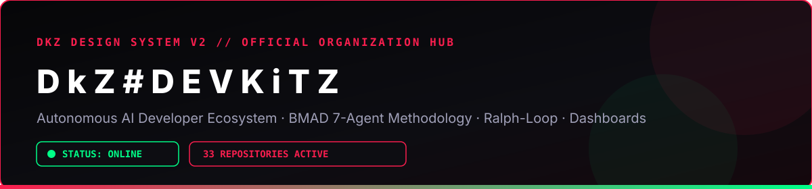

   

---

## 🗂️ PROJEKTE & ANGEHÄNGTE REPOSITORIES (PROJECT BOARDS)

### 🖥️ Projekt 1: DEVKiTZ™ Core Dashboards, Control Center & Desktop Apps
| Repository | Rolle im Projekt | Status |
|:--|:--|:--|
| **[dkz-dashboard-v2](https://github.com/DkZ-DEVKiTZ/dkz-dashboard-v2)** | Haupt-DEVKiTZ™ Dashboard v2 (81+ Module, Shared Scripts & CSS v2) |  |
| **[dkz-ai-ecosystem](https://github.com/DkZ-DEVKiTZ/dkz-ai-ecosystem)** | Zentrales KI-Master-Repository (607+ verifizierte Quelldateien) |  |
| **[dkz-copilot-desktop](https://github.com/DkZ-DEVKiTZ/dkz-copilot-desktop)** | DkZ Copilot Desktop App (Electron), Mobile Terminal & Browser-Agent |  |
| **[dkz-copilot](https://github.com/DkZ-DEVKiTZ/dkz-copilot)** | DkZ Copilot Core Assistant & James™ Context Pipeline |  |
| **[dkz-center](https://github.com/DkZ-DEVKiTZ/dkz-center)** | DkZ System Control Center & Launcher |  |
| **[dkz-github-hub](https://github.com/DkZ-DEVKiTZ/dkz-github-hub)** | GitHub Fusion Dashboard (5 Tabs, 7 Systeme, 8 Loops, Aegis Obsidian) |  |
| **[dkz-aiaikirk](https://github.com/DkZ-DEVKiTZ/dkz-aiaikirk)** | AiAiKirk Desktop- & Automatisierungs-System |  |

### 🤖 Projekt 2: Multi-Agent Swarms, BMAD™, Hermes & MCP Backend
| Repository | Rolle im Projekt | Status |
|:--|:--|:--|
| **[dkz-hermes-ecosystem](https://github.com/DkZ-DEVKiTZ/dkz-hermes-ecosystem)** | Hermes Agent, Hermes Desktop, Skill Factory & Super-Hermes |  |
| **[dkz-nemotron-swarm](https://github.com/DkZ-DEVKiTZ/dkz-nemotron-swarm)** | Nemotron Multi-Agent Swarm Orchestrierung |  |
| **[dkz-agent-ecosystem](https://github.com/DkZ-DEVKiTZ/dkz-agent-ecosystem)** | BMAD™ 7-Agenten-Architektur & Ralph-Loop™ |  |
| **[dkz-skills-and-agents-pack](https://github.com/DkZ-DEVKiTZ/dkz-skills-and-agents-pack)** | DkZ Master-Skillpack, Standards Core, Webapp Builder & OpenCode Bridges |  |
| **[dkz-agent-skills](https://github.com/DkZ-DEVKiTZ/dkz-agent-skills)** | Validierte Delivery- & Automatisierungs-Skills |  |
| **[dkz-github-delivery](https://github.com/DkZ-DEVKiTZ/dkz-github-delivery)** | Reproduzierbare GitHub-Delivery-Pipeline & Prüfsummen-Verifikation |  |
| **[dkz-ontherun-mcp](https://github.com/DkZ-DEVKiTZ/dkz-ontherun-mcp)** | ONTHERUN™ Node.js/Express MCP Server & OpenObserve-Anbindung |  |

### 🌐 Projekt 3: AI Worlds, Knowledge Hubs, Cloud Guard & Apps
| Repository | Rolle im Projekt | Status |
|:--|:--|:--|
| **[dkz-impossible-ai-worlds](https://github.com/DkZ-DEVKiTZ/dkz-impossible-ai-worlds)** | Impossible AI Worlds / Weltenlabor (inkl. 10.000 Modellfälle) |  |
| **[dkz-phase-two-architect](https://github.com/DkZ-DEVKiTZ/dkz-phase-two-architect)** | Phase Two Architect Hub & Worlds Engine |  |
| **[dkz-knowledge-hubs](https://github.com/DkZ-DEVKiTZ/dkz-knowledge-hubs)** | Walkthroughs Hub, Wiki Hub, Hub Landing & DeepSeek Wissensdatenbank |  |
| **[dkz-core-wiki-openclaw](https://github.com/DkZ-DEVKiTZ/dkz-core-wiki-openclaw)** | DkZ Core System Wiki & OpenClaw Framework |  |
| **[dkz-research-archive](https://github.com/DkZ-DEVKiTZ/dkz-research-archive)** | Research-Archiv (572 Dateien, Analysen & PDF-Rebuilds) |  |
| **[dkz-chat](https://github.com/DkZ-DEVKiTZ/dkz-chat)** · **[dkz-files](https://github.com/DkZ-DEVKiTZ/dkz-files)** · **[dkz-keep](https://github.com/DkZ-DEVKiTZ/dkz-keep)** · **[dkz-translate](https://github.com/DkZ-DEVKiTZ/dkz-translate)** · **[dkz-cloud-guard](https://github.com/DkZ-DEVKiTZ/dkz-cloud-guard)** | DkZ Produktivitäts- & Security-Applikationen |  |

---

## 📡 LIVE RELEASE-, UPDATE- & ACTIVITY-BLOG (WAS ZULETZT GEMACHT WURDE)

> **Neueste Releases, Commits & Modul-Updates in DkZ-DEVKiTZ:**

### 🔥 Release-Highlights (2026-10-23)
- **🚀 [NEW RELEASE 2.0.0] Workspace-Komplett-Upload (17 neue Repositories):** Das Haupt-Dashboard (dkz-dashboard-v2), dkz-copilot-desktop, dkz-hermes-ecosystem, dkz-nemotron-swarm, dkz-ontherun-mcp, dkz-github-hub, dkz-aiaikirk, dkz-knowledge-hubs und alle DkZ-Apps wurden aus C:\\DEVKiTZ im 7-Ordner-Standard veröffentlicht.
- **📦 [NEW RELEASE 2.1.0] dkz-ai-ecosystem & dkz-github-delivery:** Vollständiger Sync der 607 DkZ-Quelldateien, dkz-impossible-ai-worlds (10.000 Modellfälle) und dkz-phase-two-architect.
- **🎨 [DESIGN SYSTEM V2] Einheitliches DkZ™ Branding:** Alle Repositories verfügen über das Obsidian/Crimson/Matrix-Green Farbschema (#060608 / #fa1e4e / #00ff88), eigene SVG-Hero-Banner, interaktive HTML-Demos und SHA-1 Dateiverzeichnisse.

### 📋 Chronologisches Update- & Release-Log (Live-Feed)
| Datum / Uhrzeit | Repository | Aktion / Release | Details & Änderungen |
|:--|:--|:--|:--|
| $dateStr | **[$(@{id=1431415297; node_id=R_kgDOVVGqAQ; name=dkz-skills-and-agents-pack; full_name=DkZ-DEVKiTZ/dkz-skills-and-agents-pack; private=True; owner=; html_url=https://github.com/DkZ-DEVKiTZ/dkz-skills-and-agents-pack; description=DkZ Skillpack, Standards Core, Webapp Builder, Superpowers & OpenCode Bridges; fork=False; url=https://api.github.com/repos/DkZ-DEVKiTZ/dkz-skills-and-agents-pack; forks_url=https://api.github.com/repos/DkZ-DEVKiTZ/dkz-skills-and-agents-pack/forks; keys_url=https://api.github.com/repos/DkZ-DEVKiTZ/dkz-skills-and-agents-pack/keys{/key_id}; collaborators_url=https://api.github.com/repos/DkZ-DEVKiTZ/dkz-skills-and-agents-pack/collaborators{/collaborator}; teams_url=https://api.github.com/repos/DkZ-DEVKiTZ/dkz-skills-and-agents-pack/teams; hooks_url=https://api.github.com/repos/DkZ-DEVKiTZ/dkz-skills-and-agents-pack/hooks; issue_events_url=https://api.github.com/repos/DkZ-DEVKiTZ/dkz-skills-and-agents-pack/issues/events{/number}; events_url=https://api.github.com/repos/DkZ-DEVKiTZ/dkz-skills-and-agents-pack/events; assignees_url=https://api.github.com/repos/DkZ-DEVKiTZ/dkz-skills-and-agents-pack/assignees{/user}; branches_url=https://api.github.com/repos/DkZ-DEVKiTZ/dkz-skills-and-agents-pack/branches{/branch}; tags_url=https://api.github.com/repos/DkZ-DEVKiTZ/dkz-skills-and-agents-pack/tags; blobs_url=https://api.github.com/repos/DkZ-DEVKiTZ/dkz-skills-and-agents-pack/git/blobs{/sha}; git_tags_url=https://api.github.com/repos/DkZ-DEVKiTZ/dkz-skills-and-agents-pack/git/tags{/sha}; git_refs_url=https://api.github.com/repos/DkZ-DEVKiTZ/dkz-skills-and-agents-pack/git/refs{/sha}; trees_url=https://api.github.com/repos/DkZ-DEVKiTZ/dkz-skills-and-agents-pack/git/trees{/sha}; statuses_url=https://api.github.com/repos/DkZ-DEVKiTZ/dkz-skills-and-agents-pack/statuses/{sha}; languages_url=https://api.github.com/repos/DkZ-DEVKiTZ/dkz-skills-and-agents-pack/languages; stargazers_url=https://api.github.com/repos/DkZ-DEVKiTZ/dkz-skills-and-agents-pack/stargazers; contributors_url=https://api.github.com/repos/DkZ-DEVKiTZ/dkz-skills-and-agents-pack/contributors; subscribers_url=https://api.github.com/repos/DkZ-DEVKiTZ/dkz-skills-and-agents-pack/subscribers; subscription_url=https://api.github.com/repos/DkZ-DEVKiTZ/dkz-skills-and-agents-pack/subscription; commits_url=https://api.github.com/repos/DkZ-DEVKiTZ/dkz-skills-and-agents-pack/commits{/sha}; git_commits_url=https://api.github.com/repos/DkZ-DEVKiTZ/dkz-skills-and-agents-pack/git/commits{/sha}; comments_url=https://api.github.com/repos/DkZ-DEVKiTZ/dkz-skills-and-agents-pack/comments{/number}; issue_comment_url=https://api.github.com/repos/DkZ-DEVKiTZ/dkz-skills-and-agents-pack/issues/comments{/number}; contents_url=https://api.github.com/repos/DkZ-DEVKiTZ/dkz-skills-and-agents-pack/contents/{+path}; compare_url=https://api.github.com/repos/DkZ-DEVKiTZ/dkz-skills-and-agents-pack/compare/{base}...{head}; merges_url=https://api.github.com/repos/DkZ-DEVKiTZ/dkz-skills-and-agents-pack/merges; archive_url=https://api.github.com/repos/DkZ-DEVKiTZ/dkz-skills-and-agents-pack/{archive_format}{/ref}; downloads_url=https://api.github.com/repos/DkZ-DEVKiTZ/dkz-skills-and-agents-pack/downloads; issues_url=https://api.github.com/repos/DkZ-DEVKiTZ/dkz-skills-and-agents-pack/issues{/number}; pulls_url=https://api.github.com/repos/DkZ-DEVKiTZ/dkz-skills-and-agents-pack/pulls{/number}; milestones_url=https://api.github.com/repos/DkZ-DEVKiTZ/dkz-skills-and-agents-pack/milestones{/number}; notifications_url=https://api.github.com/repos/DkZ-DEVKiTZ/dkz-skills-and-agents-pack/notifications{?since,all,participating}; labels_url=https://api.github.com/repos/DkZ-DEVKiTZ/dkz-skills-and-agents-pack/labels{/name}; releases_url=https://api.github.com/repos/DkZ-DEVKiTZ/dkz-skills-and-agents-pack/releases{/id}; deployments_url=https://api.github.com/repos/DkZ-DEVKiTZ/dkz-skills-and-agents-pack/deployments; created_at=2026-10-23T18:33:48Z; updated_at=2026-10-23T18:34:05Z; pushed_at=2026-10-23T18:33:55Z; git_url=git://github.com/DkZ-DEVKiTZ/dkz-skills-and-agents-pack.git; ssh_url=git@github.com:DkZ-DEVKiTZ/dkz-skills-and-agents-pack.git; clone_url=https://github.com/DkZ-DEVKiTZ/dkz-skills-and-agents-pack.git; svn_url=https://github.com/DkZ-DEVKiTZ/dkz-skills-and-agents-pack; homepage=; size=6797; stargazers_count=0; watchers_count=0; language=HTML; has_issues=True; has_projects=True; has_downloads=False; has_wiki=False; has_pages=False; has_discussions=False; forks_count=0; mirror_url=; archived=False; disabled=False; open_issues_count=0; license=; allow_forking=False; is_template=False; web_commit_signoff_required=False; has_pull_requests=True; pull_request_creation_policy=all; topics=System.Object[]; visibility=private; forks=0; open_issues=0; watchers=0; default_branch=main; permissions=; security_and_analysis=; custom_properties=}.name)](https://github.com/DkZ-DEVKiTZ/dkz-skills-and-agents-pack)** |  | DkZ Skillpack, Standards Core, Webapp Builder, Superpowers & OpenCode Bridges |
| $dateStr | **[$(@{id=1431414669; node_id=R_kgDOVVGnjQ; name=dkz-knowledge-hubs; full_name=DkZ-DEVKiTZ/dkz-knowledge-hubs; private=True; owner=; html_url=https://github.com/DkZ-DEVKiTZ/dkz-knowledge-hubs; description=DkZ Walkthroughs Hub, Wiki Hub, Hub Landing & DeepSeek Knowledgebase; fork=False; url=https://api.github.com/repos/DkZ-DEVKiTZ/dkz-knowledge-hubs; forks_url=https://api.github.com/repos/DkZ-DEVKiTZ/dkz-knowledge-hubs/forks; keys_url=https://api.github.com/repos/DkZ-DEVKiTZ/dkz-knowledge-hubs/keys{/key_id}; collaborators_url=https://api.github.com/repos/DkZ-DEVKiTZ/dkz-knowledge-hubs/collaborators{/collaborator}; teams_url=https://api.github.com/repos/DkZ-DEVKiTZ/dkz-knowledge-hubs/teams; hooks_url=https://api.github.com/repos/DkZ-DEVKiTZ/dkz-knowledge-hubs/hooks; issue_events_url=https://api.github.com/repos/DkZ-DEVKiTZ/dkz-knowledge-hubs/issues/events{/number}; events_url=https://api.github.com/repos/DkZ-DEVKiTZ/dkz-knowledge-hubs/events; assignees_url=https://api.github.com/repos/DkZ-DEVKiTZ/dkz-knowledge-hubs/assignees{/user}; branches_url=https://api.github.com/repos/DkZ-DEVKiTZ/dkz-knowledge-hubs/branches{/branch}; tags_url=https://api.github.com/repos/DkZ-DEVKiTZ/dkz-knowledge-hubs/tags; blobs_url=https://api.github.com/repos/DkZ-DEVKiTZ/dkz-knowledge-hubs/git/blobs{/sha}; git_tags_url=https://api.github.com/repos/DkZ-DEVKiTZ/dkz-knowledge-hubs/git/tags{/sha}; git_refs_url=https://api.github.com/repos/DkZ-DEVKiTZ/dkz-knowledge-hubs/git/refs{/sha}; trees_url=https://api.github.com/repos/DkZ-DEVKiTZ/dkz-knowledge-hubs/git/trees{/sha}; statuses_url=https://api.github.com/repos/DkZ-DEVKiTZ/dkz-knowledge-hubs/statuses/{sha}; languages_url=https://api.github.com/repos/DkZ-DEVKiTZ/dkz-knowledge-hubs/languages; stargazers_url=https://api.github.com/repos/DkZ-DEVKiTZ/dkz-knowledge-hubs/stargazers; contributors_url=https://api.github.com/repos/DkZ-DEVKiTZ/dkz-knowledge-hubs/contributors; subscribers_url=https://api.github.com/repos/DkZ-DEVKiTZ/dkz-knowledge-hubs/subscribers; subscription_url=https://api.github.com/repos/DkZ-DEVKiTZ/dkz-knowledge-hubs/subscription; commits_url=https://api.github.com/repos/DkZ-DEVKiTZ/dkz-knowledge-hubs/commits{/sha}; git_commits_url=https://api.github.com/repos/DkZ-DEVKiTZ/dkz-knowledge-hubs/git/commits{/sha}; comments_url=https://api.github.com/repos/DkZ-DEVKiTZ/dkz-knowledge-hubs/comments{/number}; issue_comment_url=https://api.github.com/repos/DkZ-DEVKiTZ/dkz-knowledge-hubs/issues/comments{/number}; contents_url=https://api.github.com/repos/DkZ-DEVKiTZ/dkz-knowledge-hubs/contents/{+path}; compare_url=https://api.github.com/repos/DkZ-DEVKiTZ/dkz-knowledge-hubs/compare/{base}...{head}; merges_url=https://api.github.com/repos/DkZ-DEVKiTZ/dkz-knowledge-hubs/merges; archive_url=https://api.github.com/repos/DkZ-DEVKiTZ/dkz-knowledge-hubs/{archive_format}{/ref}; downloads_url=https://api.github.com/repos/DkZ-DEVKiTZ/dkz-knowledge-hubs/downloads; issues_url=https://api.github.com/repos/DkZ-DEVKiTZ/dkz-knowledge-hubs/issues{/number}; pulls_url=https://api.github.com/repos/DkZ-DEVKiTZ/dkz-knowledge-hubs/pulls{/number}; milestones_url=https://api.github.com/repos/DkZ-DEVKiTZ/dkz-knowledge-hubs/milestones{/number}; notifications_url=https://api.github.com/repos/DkZ-DEVKiTZ/dkz-knowledge-hubs/notifications{?since,all,participating}; labels_url=https://api.github.com/repos/DkZ-DEVKiTZ/dkz-knowledge-hubs/labels{/name}; releases_url=https://api.github.com/repos/DkZ-DEVKiTZ/dkz-knowledge-hubs/releases{/id}; deployments_url=https://api.github.com/repos/DkZ-DEVKiTZ/dkz-knowledge-hubs/deployments; created_at=2026-10-23T18:33:07Z; updated_at=2026-10-23T18:33:22Z; pushed_at=2026-10-23T18:33:16Z; git_url=git://github.com/DkZ-DEVKiTZ/dkz-knowledge-hubs.git; ssh_url=git@github.com:DkZ-DEVKiTZ/dkz-knowledge-hubs.git; clone_url=https://github.com/DkZ-DEVKiTZ/dkz-knowledge-hubs.git; svn_url=https://github.com/DkZ-DEVKiTZ/dkz-knowledge-hubs; homepage=; size=3157; stargazers_count=0; watchers_count=0; language=Shell; has_issues=True; has_projects=True; has_downloads=False; has_wiki=False; has_pages=False; has_discussions=False; forks_count=0; mirror_url=; archived=False; disabled=False; open_issues_count=0; license=; allow_forking=False; is_template=False; web_commit_signoff_required=False; has_pull_requests=True; pull_request_creation_policy=all; topics=System.Object[]; visibility=private; forks=0; open_issues=0; watchers=0; default_branch=main; permissions=; security_and_analysis=; custom_properties=}.name)](https://github.com/DkZ-DEVKiTZ/dkz-knowledge-hubs)** |  | DkZ Walkthroughs Hub, Wiki Hub, Hub Landing & DeepSeek Knowledgebase |
| $dateStr | **[$(@{id=1431414459; node_id=R_kgDOVVGmuw; name=dkz-hermes-ecosystem; full_name=DkZ-DEVKiTZ/dkz-hermes-ecosystem; private=True; owner=; html_url=https://github.com/DkZ-DEVKiTZ/dkz-hermes-ecosystem; description=Complete Hermes Agent Suite: Hermes Agent, Desktop, Skill Factory & Super-Hermes; fork=False; url=https://api.github.com/repos/DkZ-DEVKiTZ/dkz-hermes-ecosystem; forks_url=https://api.github.com/repos/DkZ-DEVKiTZ/dkz-hermes-ecosystem/forks; keys_url=https://api.github.com/repos/DkZ-DEVKiTZ/dkz-hermes-ecosystem/keys{/key_id}; collaborators_url=https://api.github.com/repos/DkZ-DEVKiTZ/dkz-hermes-ecosystem/collaborators{/collaborator}; teams_url=https://api.github.com/repos/DkZ-DEVKiTZ/dkz-hermes-ecosystem/teams; hooks_url=https://api.github.com/repos/DkZ-DEVKiTZ/dkz-hermes-ecosystem/hooks; issue_events_url=https://api.github.com/repos/DkZ-DEVKiTZ/dkz-hermes-ecosystem/issues/events{/number}; events_url=https://api.github.com/repos/DkZ-DEVKiTZ/dkz-hermes-ecosystem/events; assignees_url=https://api.github.com/repos/DkZ-DEVKiTZ/dkz-hermes-ecosystem/assignees{/user}; branches_url=https://api.github.com/repos/DkZ-DEVKiTZ/dkz-hermes-ecosystem/branches{/branch}; tags_url=https://api.github.com/repos/DkZ-DEVKiTZ/dkz-hermes-ecosystem/tags; blobs_url=https://api.github.com/repos/DkZ-DEVKiTZ/dkz-hermes-ecosystem/git/blobs{/sha}; git_tags_url=https://api.github.com/repos/DkZ-DEVKiTZ/dkz-hermes-ecosystem/git/tags{/sha}; git_refs_url=https://api.github.com/repos/DkZ-DEVKiTZ/dkz-hermes-ecosystem/git/refs{/sha}; trees_url=https://api.github.com/repos/DkZ-DEVKiTZ/dkz-hermes-ecosystem/git/trees{/sha}; statuses_url=https://api.github.com/repos/DkZ-DEVKiTZ/dkz-hermes-ecosystem/statuses/{sha}; languages_url=https://api.github.com/repos/DkZ-DEVKiTZ/dkz-hermes-ecosystem/languages; stargazers_url=https://api.github.com/repos/DkZ-DEVKiTZ/dkz-hermes-ecosystem/stargazers; contributors_url=https://api.github.com/repos/DkZ-DEVKiTZ/dkz-hermes-ecosystem/contributors; subscribers_url=https://api.github.com/repos/DkZ-DEVKiTZ/dkz-hermes-ecosystem/subscribers; subscription_url=https://api.github.com/repos/DkZ-DEVKiTZ/dkz-hermes-ecosystem/subscription; commits_url=https://api.github.com/repos/DkZ-DEVKiTZ/dkz-hermes-ecosystem/commits{/sha}; git_commits_url=https://api.github.com/repos/DkZ-DEVKiTZ/dkz-hermes-ecosystem/git/commits{/sha}; comments_url=https://api.github.com/repos/DkZ-DEVKiTZ/dkz-hermes-ecosystem/comments{/number}; issue_comment_url=https://api.github.com/repos/DkZ-DEVKiTZ/dkz-hermes-ecosystem/issues/comments{/number}; contents_url=https://api.github.com/repos/DkZ-DEVKiTZ/dkz-hermes-ecosystem/contents/{+path}; compare_url=https://api.github.com/repos/DkZ-DEVKiTZ/dkz-hermes-ecosystem/compare/{base}...{head}; merges_url=https://api.github.com/repos/DkZ-DEVKiTZ/dkz-hermes-ecosystem/merges; archive_url=https://api.github.com/repos/DkZ-DEVKiTZ/dkz-hermes-ecosystem/{archive_format}{/ref}; downloads_url=https://api.github.com/repos/DkZ-DEVKiTZ/dkz-hermes-ecosystem/downloads; issues_url=https://api.github.com/repos/DkZ-DEVKiTZ/dkz-hermes-ecosystem/issues{/number}; pulls_url=https://api.github.com/repos/DkZ-DEVKiTZ/dkz-hermes-ecosystem/pulls{/number}; milestones_url=https://api.github.com/repos/DkZ-DEVKiTZ/dkz-hermes-ecosystem/milestones{/number}; notifications_url=https://api.github.com/repos/DkZ-DEVKiTZ/dkz-hermes-ecosystem/notifications{?since,all,participating}; labels_url=https://api.github.com/repos/DkZ-DEVKiTZ/dkz-hermes-ecosystem/labels{/name}; releases_url=https://api.github.com/repos/DkZ-DEVKiTZ/dkz-hermes-ecosystem/releases{/id}; deployments_url=https://api.github.com/repos/DkZ-DEVKiTZ/dkz-hermes-ecosystem/deployments; created_at=2026-10-23T18:32:54Z; updated_at=2026-10-23T18:33:12Z; pushed_at=2026-10-23T18:33:01Z; git_url=git://github.com/DkZ-DEVKiTZ/dkz-hermes-ecosystem.git; ssh_url=git@github.com:DkZ-DEVKiTZ/dkz-hermes-ecosystem.git; clone_url=https://github.com/DkZ-DEVKiTZ/dkz-hermes-ecosystem.git; svn_url=https://github.com/DkZ-DEVKiTZ/dkz-hermes-ecosystem; homepage=; size=9994; stargazers_count=0; watchers_count=0; language=Python; has_issues=True; has_projects=True; has_downloads=False; has_wiki=False; has_pages=False; has_discussions=False; forks_count=0; mirror_url=; archived=False; disabled=False; open_issues_count=0; license=; allow_forking=False; is_template=False; web_commit_signoff_required=False; has_pull_requests=True; pull_request_creation_policy=all; topics=System.Object[]; visibility=private; forks=0; open_issues=0; watchers=0; default_branch=main; permissions=; security_and_analysis=; custom_properties=}.name)](https://github.com/DkZ-DEVKiTZ/dkz-hermes-ecosystem)** |  | Complete Hermes Agent Suite: Hermes Agent, Desktop, Skill Factory & Super-Hermes |
| $dateStr | **[$(@{id=1431413771; node_id=R_kgDOVVGkCw; name=dkz-ontherun-mcp; full_name=DkZ-DEVKiTZ/dkz-ontherun-mcp; private=True; owner=; html_url=https://github.com/DkZ-DEVKiTZ/dkz-ontherun-mcp; description=ONTHERUN MCP Server, OpenObserve Integration & Backend Services; fork=False; url=https://api.github.com/repos/DkZ-DEVKiTZ/dkz-ontherun-mcp; forks_url=https://api.github.com/repos/DkZ-DEVKiTZ/dkz-ontherun-mcp/forks; keys_url=https://api.github.com/repos/DkZ-DEVKiTZ/dkz-ontherun-mcp/keys{/key_id}; collaborators_url=https://api.github.com/repos/DkZ-DEVKiTZ/dkz-ontherun-mcp/collaborators{/collaborator}; teams_url=https://api.github.com/repos/DkZ-DEVKiTZ/dkz-ontherun-mcp/teams; hooks_url=https://api.github.com/repos/DkZ-DEVKiTZ/dkz-ontherun-mcp/hooks; issue_events_url=https://api.github.com/repos/DkZ-DEVKiTZ/dkz-ontherun-mcp/issues/events{/number}; events_url=https://api.github.com/repos/DkZ-DEVKiTZ/dkz-ontherun-mcp/events; assignees_url=https://api.github.com/repos/DkZ-DEVKiTZ/dkz-ontherun-mcp/assignees{/user}; branches_url=https://api.github.com/repos/DkZ-DEVKiTZ/dkz-ontherun-mcp/branches{/branch}; tags_url=https://api.github.com/repos/DkZ-DEVKiTZ/dkz-ontherun-mcp/tags; blobs_url=https://api.github.com/repos/DkZ-DEVKiTZ/dkz-ontherun-mcp/git/blobs{/sha}; git_tags_url=https://api.github.com/repos/DkZ-DEVKiTZ/dkz-ontherun-mcp/git/tags{/sha}; git_refs_url=https://api.github.com/repos/DkZ-DEVKiTZ/dkz-ontherun-mcp/git/refs{/sha}; trees_url=https://api.github.com/repos/DkZ-DEVKiTZ/dkz-ontherun-mcp/git/trees{/sha}; statuses_url=https://api.github.com/repos/DkZ-DEVKiTZ/dkz-ontherun-mcp/statuses/{sha}; languages_url=https://api.github.com/repos/DkZ-DEVKiTZ/dkz-ontherun-mcp/languages; stargazers_url=https://api.github.com/repos/DkZ-DEVKiTZ/dkz-ontherun-mcp/stargazers; contributors_url=https://api.github.com/repos/DkZ-DEVKiTZ/dkz-ontherun-mcp/contributors; subscribers_url=https://api.github.com/repos/DkZ-DEVKiTZ/dkz-ontherun-mcp/subscribers; subscription_url=https://api.github.com/repos/DkZ-DEVKiTZ/dkz-ontherun-mcp/subscription; commits_url=https://api.github.com/repos/DkZ-DEVKiTZ/dkz-ontherun-mcp/commits{/sha}; git_commits_url=https://api.github.com/repos/DkZ-DEVKiTZ/dkz-ontherun-mcp/git/commits{/sha}; comments_url=https://api.github.com/repos/DkZ-DEVKiTZ/dkz-ontherun-mcp/comments{/number}; issue_comment_url=https://api.github.com/repos/DkZ-DEVKiTZ/dkz-ontherun-mcp/issues/comments{/number}; contents_url=https://api.github.com/repos/DkZ-DEVKiTZ/dkz-ontherun-mcp/contents/{+path}; compare_url=https://api.github.com/repos/DkZ-DEVKiTZ/dkz-ontherun-mcp/compare/{base}...{head}; merges_url=https://api.github.com/repos/DkZ-DEVKiTZ/dkz-ontherun-mcp/merges; archive_url=https://api.github.com/repos/DkZ-DEVKiTZ/dkz-ontherun-mcp/{archive_format}{/ref}; downloads_url=https://api.github.com/repos/DkZ-DEVKiTZ/dkz-ontherun-mcp/downloads; issues_url=https://api.github.com/repos/DkZ-DEVKiTZ/dkz-ontherun-mcp/issues{/number}; pulls_url=https://api.github.com/repos/DkZ-DEVKiTZ/dkz-ontherun-mcp/pulls{/number}; milestones_url=https://api.github.com/repos/DkZ-DEVKiTZ/dkz-ontherun-mcp/milestones{/number}; notifications_url=https://api.github.com/repos/DkZ-DEVKiTZ/dkz-ontherun-mcp/notifications{?since,all,participating}; labels_url=https://api.github.com/repos/DkZ-DEVKiTZ/dkz-ontherun-mcp/labels{/name}; releases_url=https://api.github.com/repos/DkZ-DEVKiTZ/dkz-ontherun-mcp/releases{/id}; deployments_url=https://api.github.com/repos/DkZ-DEVKiTZ/dkz-ontherun-mcp/deployments; created_at=2026-10-23T18:32:13Z; updated_at=2026-10-23T18:32:25Z; pushed_at=2026-10-23T18:32:18Z; git_url=git://github.com/DkZ-DEVKiTZ/dkz-ontherun-mcp.git; ssh_url=git@github.com:DkZ-DEVKiTZ/dkz-ontherun-mcp.git; clone_url=https://github.com/DkZ-DEVKiTZ/dkz-ontherun-mcp.git; svn_url=https://github.com/DkZ-DEVKiTZ/dkz-ontherun-mcp; homepage=; size=4231; stargazers_count=0; watchers_count=0; language=Python; has_issues=True; has_projects=True; has_downloads=False; has_wiki=False; has_pages=False; has_discussions=False; forks_count=0; mirror_url=; archived=False; disabled=False; open_issues_count=0; license=; allow_forking=False; is_template=False; web_commit_signoff_required=False; has_pull_requests=True; pull_request_creation_policy=all; topics=System.Object[]; visibility=private; forks=0; open_issues=0; watchers=0; default_branch=main; permissions=; security_and_analysis=; custom_properties=}.name)](https://github.com/DkZ-DEVKiTZ/dkz-ontherun-mcp)** |  | ONTHERUN MCP Server, OpenObserve Integration & Backend Services |
| $dateStr | **[$(@{id=1431413047; node_id=R_kgDOVVGhNw; name=dkz-nemotron-swarm; full_name=DkZ-DEVKiTZ/dkz-nemotron-swarm; private=True; owner=; html_url=https://github.com/DkZ-DEVKiTZ/dkz-nemotron-swarm; description=DkZ Nemotron Swarm Orchestration & Multi-Agent Engine; fork=False; url=https://api.github.com/repos/DkZ-DEVKiTZ/dkz-nemotron-swarm; forks_url=https://api.github.com/repos/DkZ-DEVKiTZ/dkz-nemotron-swarm/forks; keys_url=https://api.github.com/repos/DkZ-DEVKiTZ/dkz-nemotron-swarm/keys{/key_id}; collaborators_url=https://api.github.com/repos/DkZ-DEVKiTZ/dkz-nemotron-swarm/collaborators{/collaborator}; teams_url=https://api.github.com/repos/DkZ-DEVKiTZ/dkz-nemotron-swarm/teams; hooks_url=https://api.github.com/repos/DkZ-DEVKiTZ/dkz-nemotron-swarm/hooks; issue_events_url=https://api.github.com/repos/DkZ-DEVKiTZ/dkz-nemotron-swarm/issues/events{/number}; events_url=https://api.github.com/repos/DkZ-DEVKiTZ/dkz-nemotron-swarm/events; assignees_url=https://api.github.com/repos/DkZ-DEVKiTZ/dkz-nemotron-swarm/assignees{/user}; branches_url=https://api.github.com/repos/DkZ-DEVKiTZ/dkz-nemotron-swarm/branches{/branch}; tags_url=https://api.github.com/repos/DkZ-DEVKiTZ/dkz-nemotron-swarm/tags; blobs_url=https://api.github.com/repos/DkZ-DEVKiTZ/dkz-nemotron-swarm/git/blobs{/sha}; git_tags_url=https://api.github.com/repos/DkZ-DEVKiTZ/dkz-nemotron-swarm/git/tags{/sha}; git_refs_url=https://api.github.com/repos/DkZ-DEVKiTZ/dkz-nemotron-swarm/git/refs{/sha}; trees_url=https://api.github.com/repos/DkZ-DEVKiTZ/dkz-nemotron-swarm/git/trees{/sha}; statuses_url=https://api.github.com/repos/DkZ-DEVKiTZ/dkz-nemotron-swarm/statuses/{sha}; languages_url=https://api.github.com/repos/DkZ-DEVKiTZ/dkz-nemotron-swarm/languages; stargazers_url=https://api.github.com/repos/DkZ-DEVKiTZ/dkz-nemotron-swarm/stargazers; contributors_url=https://api.github.com/repos/DkZ-DEVKiTZ/dkz-nemotron-swarm/contributors; subscribers_url=https://api.github.com/repos/DkZ-DEVKiTZ/dkz-nemotron-swarm/subscribers; subscription_url=https://api.github.com/repos/DkZ-DEVKiTZ/dkz-nemotron-swarm/subscription; commits_url=https://api.github.com/repos/DkZ-DEVKiTZ/dkz-nemotron-swarm/commits{/sha}; git_commits_url=https://api.github.com/repos/DkZ-DEVKiTZ/dkz-nemotron-swarm/git/commits{/sha}; comments_url=https://api.github.com/repos/DkZ-DEVKiTZ/dkz-nemotron-swarm/comments{/number}; issue_comment_url=https://api.github.com/repos/DkZ-DEVKiTZ/dkz-nemotron-swarm/issues/comments{/number}; contents_url=https://api.github.com/repos/DkZ-DEVKiTZ/dkz-nemotron-swarm/contents/{+path}; compare_url=https://api.github.com/repos/DkZ-DEVKiTZ/dkz-nemotron-swarm/compare/{base}...{head}; merges_url=https://api.github.com/repos/DkZ-DEVKiTZ/dkz-nemotron-swarm/merges; archive_url=https://api.github.com/repos/DkZ-DEVKiTZ/dkz-nemotron-swarm/{archive_format}{/ref}; downloads_url=https://api.github.com/repos/DkZ-DEVKiTZ/dkz-nemotron-swarm/downloads; issues_url=https://api.github.com/repos/DkZ-DEVKiTZ/dkz-nemotron-swarm/issues{/number}; pulls_url=https://api.github.com/repos/DkZ-DEVKiTZ/dkz-nemotron-swarm/pulls{/number}; milestones_url=https://api.github.com/repos/DkZ-DEVKiTZ/dkz-nemotron-swarm/milestones{/number}; notifications_url=https://api.github.com/repos/DkZ-DEVKiTZ/dkz-nemotron-swarm/notifications{?since,all,participating}; labels_url=https://api.github.com/repos/DkZ-DEVKiTZ/dkz-nemotron-swarm/labels{/name}; releases_url=https://api.github.com/repos/DkZ-DEVKiTZ/dkz-nemotron-swarm/releases{/id}; deployments_url=https://api.github.com/repos/DkZ-DEVKiTZ/dkz-nemotron-swarm/deployments; created_at=2026-10-23T18:31:25Z; updated_at=2026-10-23T18:31:33Z; pushed_at=2026-10-23T18:31:29Z; git_url=git://github.com/DkZ-DEVKiTZ/dkz-nemotron-swarm.git; ssh_url=git@github.com:DkZ-DEVKiTZ/dkz-nemotron-swarm.git; clone_url=https://github.com/DkZ-DEVKiTZ/dkz-nemotron-swarm.git; svn_url=https://github.com/DkZ-DEVKiTZ/dkz-nemotron-swarm; homepage=; size=29; stargazers_count=0; watchers_count=0; language=Python; has_issues=True; has_projects=True; has_downloads=False; has_wiki=False; has_pages=False; has_discussions=False; forks_count=0; mirror_url=; archived=False; disabled=False; open_issues_count=0; license=; allow_forking=False; is_template=False; web_commit_signoff_required=False; has_pull_requests=True; pull_request_creation_policy=all; topics=System.Object[]; visibility=private; forks=0; open_issues=0; watchers=0; default_branch=main; permissions=; security_and_analysis=; custom_properties=}.name)](https://github.com/DkZ-DEVKiTZ/dkz-nemotron-swarm)** |  | DkZ Nemotron Swarm Orchestration & Multi-Agent Engine |
| $dateStr | **[$(@{id=1431412910; node_id=R_kgDOVVGgrg; name=dkz-aiaikirk; full_name=DkZ-DEVKiTZ/dkz-aiaikirk; private=True; owner=; html_url=https://github.com/DkZ-DEVKiTZ/dkz-aiaikirk; description=DkZ AiAiKirk AI Desktop & Automation Suite; fork=False; url=https://api.github.com/repos/DkZ-DEVKiTZ/dkz-aiaikirk; forks_url=https://api.github.com/repos/DkZ-DEVKiTZ/dkz-aiaikirk/forks; keys_url=https://api.github.com/repos/DkZ-DEVKiTZ/dkz-aiaikirk/keys{/key_id}; collaborators_url=https://api.github.com/repos/DkZ-DEVKiTZ/dkz-aiaikirk/collaborators{/collaborator}; teams_url=https://api.github.com/repos/DkZ-DEVKiTZ/dkz-aiaikirk/teams; hooks_url=https://api.github.com/repos/DkZ-DEVKiTZ/dkz-aiaikirk/hooks; issue_events_url=https://api.github.com/repos/DkZ-DEVKiTZ/dkz-aiaikirk/issues/events{/number}; events_url=https://api.github.com/repos/DkZ-DEVKiTZ/dkz-aiaikirk/events; assignees_url=https://api.github.com/repos/DkZ-DEVKiTZ/dkz-aiaikirk/assignees{/user}; branches_url=https://api.github.com/repos/DkZ-DEVKiTZ/dkz-aiaikirk/branches{/branch}; tags_url=https://api.github.com/repos/DkZ-DEVKiTZ/dkz-aiaikirk/tags; blobs_url=https://api.github.com/repos/DkZ-DEVKiTZ/dkz-aiaikirk/git/blobs{/sha}; git_tags_url=https://api.github.com/repos/DkZ-DEVKiTZ/dkz-aiaikirk/git/tags{/sha}; git_refs_url=https://api.github.com/repos/DkZ-DEVKiTZ/dkz-aiaikirk/git/refs{/sha}; trees_url=https://api.github.com/repos/DkZ-DEVKiTZ/dkz-aiaikirk/git/trees{/sha}; statuses_url=https://api.github.com/repos/DkZ-DEVKiTZ/dkz-aiaikirk/statuses/{sha}; languages_url=https://api.github.com/repos/DkZ-DEVKiTZ/dkz-aiaikirk/languages; stargazers_url=https://api.github.com/repos/DkZ-DEVKiTZ/dkz-aiaikirk/stargazers; contributors_url=https://api.github.com/repos/DkZ-DEVKiTZ/dkz-aiaikirk/contributors; subscribers_url=https://api.github.com/repos/DkZ-DEVKiTZ/dkz-aiaikirk/subscribers; subscription_url=https://api.github.com/repos/DkZ-DEVKiTZ/dkz-aiaikirk/subscription; commits_url=https://api.github.com/repos/DkZ-DEVKiTZ/dkz-aiaikirk/commits{/sha}; git_commits_url=https://api.github.com/repos/DkZ-DEVKiTZ/dkz-aiaikirk/git/commits{/sha}; comments_url=https://api.github.com/repos/DkZ-DEVKiTZ/dkz-aiaikirk/comments{/number}; issue_comment_url=https://api.github.com/repos/DkZ-DEVKiTZ/dkz-aiaikirk/issues/comments{/number}; contents_url=https://api.github.com/repos/DkZ-DEVKiTZ/dkz-aiaikirk/contents/{+path}; compare_url=https://api.github.com/repos/DkZ-DEVKiTZ/dkz-aiaikirk/compare/{base}...{head}; merges_url=https://api.github.com/repos/DkZ-DEVKiTZ/dkz-aiaikirk/merges; archive_url=https://api.github.com/repos/DkZ-DEVKiTZ/dkz-aiaikirk/{archive_format}{/ref}; downloads_url=https://api.github.com/repos/DkZ-DEVKiTZ/dkz-aiaikirk/downloads; issues_url=https://api.github.com/repos/DkZ-DEVKiTZ/dkz-aiaikirk/issues{/number}; pulls_url=https://api.github.com/repos/DkZ-DEVKiTZ/dkz-aiaikirk/pulls{/number}; milestones_url=https://api.github.com/repos/DkZ-DEVKiTZ/dkz-aiaikirk/milestones{/number}; notifications_url=https://api.github.com/repos/DkZ-DEVKiTZ/dkz-aiaikirk/notifications{?since,all,participating}; labels_url=https://api.github.com/repos/DkZ-DEVKiTZ/dkz-aiaikirk/labels{/name}; releases_url=https://api.github.com/repos/DkZ-DEVKiTZ/dkz-aiaikirk/releases{/id}; deployments_url=https://api.github.com/repos/DkZ-DEVKiTZ/dkz-aiaikirk/deployments; created_at=2026-10-23T18:31:17Z; updated_at=2026-10-23T18:31:27Z; pushed_at=2026-10-23T18:31:22Z; git_url=git://github.com/DkZ-DEVKiTZ/dkz-aiaikirk.git; ssh_url=git@github.com:DkZ-DEVKiTZ/dkz-aiaikirk.git; clone_url=https://github.com/DkZ-DEVKiTZ/dkz-aiaikirk.git; svn_url=https://github.com/DkZ-DEVKiTZ/dkz-aiaikirk; homepage=; size=677; stargazers_count=0; watchers_count=0; language=Python; has_issues=True; has_projects=True; has_downloads=False; has_wiki=False; has_pages=False; has_discussions=False; forks_count=0; mirror_url=; archived=False; disabled=False; open_issues_count=0; license=; allow_forking=False; is_template=False; web_commit_signoff_required=False; has_pull_requests=True; pull_request_creation_policy=all; topics=System.Object[]; visibility=private; forks=0; open_issues=0; watchers=0; default_branch=main; permissions=; security_and_analysis=; custom_properties=}.name)](https://github.com/DkZ-DEVKiTZ/dkz-aiaikirk)** |  | DkZ AiAiKirk AI Desktop & Automation Suite |
| $dateStr | **[$(@{id=1431412701; node_id=R_kgDOVVGf3Q; name=dkz-core-wiki-openclaw; full_name=DkZ-DEVKiTZ/dkz-core-wiki-openclaw; private=True; owner=; html_url=https://github.com/DkZ-DEVKiTZ/dkz-core-wiki-openclaw; description=DkZ Core System Wiki & OpenClaw Autonomous Framework; fork=False; url=https://api.github.com/repos/DkZ-DEVKiTZ/dkz-core-wiki-openclaw; forks_url=https://api.github.com/repos/DkZ-DEVKiTZ/dkz-core-wiki-openclaw/forks; keys_url=https://api.github.com/repos/DkZ-DEVKiTZ/dkz-core-wiki-openclaw/keys{/key_id}; collaborators_url=https://api.github.com/repos/DkZ-DEVKiTZ/dkz-core-wiki-openclaw/collaborators{/collaborator}; teams_url=https://api.github.com/repos/DkZ-DEVKiTZ/dkz-core-wiki-openclaw/teams; hooks_url=https://api.github.com/repos/DkZ-DEVKiTZ/dkz-core-wiki-openclaw/hooks; issue_events_url=https://api.github.com/repos/DkZ-DEVKiTZ/dkz-core-wiki-openclaw/issues/events{/number}; events_url=https://api.github.com/repos/DkZ-DEVKiTZ/dkz-core-wiki-openclaw/events; assignees_url=https://api.github.com/repos/DkZ-DEVKiTZ/dkz-core-wiki-openclaw/assignees{/user}; branches_url=https://api.github.com/repos/DkZ-DEVKiTZ/dkz-core-wiki-openclaw/branches{/branch}; tags_url=https://api.github.com/repos/DkZ-DEVKiTZ/dkz-core-wiki-openclaw/tags; blobs_url=https://api.github.com/repos/DkZ-DEVKiTZ/dkz-core-wiki-openclaw/git/blobs{/sha}; git_tags_url=https://api.github.com/repos/DkZ-DEVKiTZ/dkz-core-wiki-openclaw/git/tags{/sha}; git_refs_url=https://api.github.com/repos/DkZ-DEVKiTZ/dkz-core-wiki-openclaw/git/refs{/sha}; trees_url=https://api.github.com/repos/DkZ-DEVKiTZ/dkz-core-wiki-openclaw/git/trees{/sha}; statuses_url=https://api.github.com/repos/DkZ-DEVKiTZ/dkz-core-wiki-openclaw/statuses/{sha}; languages_url=https://api.github.com/repos/DkZ-DEVKiTZ/dkz-core-wiki-openclaw/languages; stargazers_url=https://api.github.com/repos/DkZ-DEVKiTZ/dkz-core-wiki-openclaw/stargazers; contributors_url=https://api.github.com/repos/DkZ-DEVKiTZ/dkz-core-wiki-openclaw/contributors; subscribers_url=https://api.github.com/repos/DkZ-DEVKiTZ/dkz-core-wiki-openclaw/subscribers; subscription_url=https://api.github.com/repos/DkZ-DEVKiTZ/dkz-core-wiki-openclaw/subscription; commits_url=https://api.github.com/repos/DkZ-DEVKiTZ/dkz-core-wiki-openclaw/commits{/sha}; git_commits_url=https://api.github.com/repos/DkZ-DEVKiTZ/dkz-core-wiki-openclaw/git/commits{/sha}; comments_url=https://api.github.com/repos/DkZ-DEVKiTZ/dkz-core-wiki-openclaw/comments{/number}; issue_comment_url=https://api.github.com/repos/DkZ-DEVKiTZ/dkz-core-wiki-openclaw/issues/comments{/number}; contents_url=https://api.github.com/repos/DkZ-DEVKiTZ/dkz-core-wiki-openclaw/contents/{+path}; compare_url=https://api.github.com/repos/DkZ-DEVKiTZ/dkz-core-wiki-openclaw/compare/{base}...{head}; merges_url=https://api.github.com/repos/DkZ-DEVKiTZ/dkz-core-wiki-openclaw/merges; archive_url=https://api.github.com/repos/DkZ-DEVKiTZ/dkz-core-wiki-openclaw/{archive_format}{/ref}; downloads_url=https://api.github.com/repos/DkZ-DEVKiTZ/dkz-core-wiki-openclaw/downloads; issues_url=https://api.github.com/repos/DkZ-DEVKiTZ/dkz-core-wiki-openclaw/issues{/number}; pulls_url=https://api.github.com/repos/DkZ-DEVKiTZ/dkz-core-wiki-openclaw/pulls{/number}; milestones_url=https://api.github.com/repos/DkZ-DEVKiTZ/dkz-core-wiki-openclaw/milestones{/number}; notifications_url=https://api.github.com/repos/DkZ-DEVKiTZ/dkz-core-wiki-openclaw/notifications{?since,all,participating}; labels_url=https://api.github.com/repos/DkZ-DEVKiTZ/dkz-core-wiki-openclaw/labels{/name}; releases_url=https://api.github.com/repos/DkZ-DEVKiTZ/dkz-core-wiki-openclaw/releases{/id}; deployments_url=https://api.github.com/repos/DkZ-DEVKiTZ/dkz-core-wiki-openclaw/deployments; created_at=2026-10-23T18:31:04Z; updated_at=2026-10-23T18:31:16Z; pushed_at=2026-10-23T18:31:10Z; git_url=git://github.com/DkZ-DEVKiTZ/dkz-core-wiki-openclaw.git; ssh_url=git@github.com:DkZ-DEVKiTZ/dkz-core-wiki-openclaw.git; clone_url=https://github.com/DkZ-DEVKiTZ/dkz-core-wiki-openclaw.git; svn_url=https://github.com/DkZ-DEVKiTZ/dkz-core-wiki-openclaw; homepage=; size=1372; stargazers_count=0; watchers_count=0; language=HTML; has_issues=True; has_projects=True; has_downloads=False; has_wiki=False; has_pages=False; has_discussions=False; forks_count=0; mirror_url=; archived=False; disabled=False; open_issues_count=0; license=; allow_forking=False; is_template=False; web_commit_signoff_required=False; has_pull_requests=True; pull_request_creation_policy=all; topics=System.Object[]; visibility=private; forks=0; open_issues=0; watchers=0; default_branch=main; permissions=; security_and_analysis=; custom_properties=}.name)](https://github.com/DkZ-DEVKiTZ/dkz-core-wiki-openclaw)** |  | DkZ Core System Wiki & OpenClaw Autonomous Framework |
| $dateStr | **[$(@{id=1431411988; node_id=R_kgDOVVGdFA; name=dkz-github-hub; full_name=DkZ-DEVKiTZ/dkz-github-hub; private=True; owner=; html_url=https://github.com/DkZ-DEVKiTZ/dkz-github-hub; description=DkZ GitHub Hub, Aegis Obsidian, Model Installer & BMAD Templates; fork=False; url=https://api.github.com/repos/DkZ-DEVKiTZ/dkz-github-hub; forks_url=https://api.github.com/repos/DkZ-DEVKiTZ/dkz-github-hub/forks; keys_url=https://api.github.com/repos/DkZ-DEVKiTZ/dkz-github-hub/keys{/key_id}; collaborators_url=https://api.github.com/repos/DkZ-DEVKiTZ/dkz-github-hub/collaborators{/collaborator}; teams_url=https://api.github.com/repos/DkZ-DEVKiTZ/dkz-github-hub/teams; hooks_url=https://api.github.com/repos/DkZ-DEVKiTZ/dkz-github-hub/hooks; issue_events_url=https://api.github.com/repos/DkZ-DEVKiTZ/dkz-github-hub/issues/events{/number}; events_url=https://api.github.com/repos/DkZ-DEVKiTZ/dkz-github-hub/events; assignees_url=https://api.github.com/repos/DkZ-DEVKiTZ/dkz-github-hub/assignees{/user}; branches_url=https://api.github.com/repos/DkZ-DEVKiTZ/dkz-github-hub/branches{/branch}; tags_url=https://api.github.com/repos/DkZ-DEVKiTZ/dkz-github-hub/tags; blobs_url=https://api.github.com/repos/DkZ-DEVKiTZ/dkz-github-hub/git/blobs{/sha}; git_tags_url=https://api.github.com/repos/DkZ-DEVKiTZ/dkz-github-hub/git/tags{/sha}; git_refs_url=https://api.github.com/repos/DkZ-DEVKiTZ/dkz-github-hub/git/refs{/sha}; trees_url=https://api.github.com/repos/DkZ-DEVKiTZ/dkz-github-hub/git/trees{/sha}; statuses_url=https://api.github.com/repos/DkZ-DEVKiTZ/dkz-github-hub/statuses/{sha}; languages_url=https://api.github.com/repos/DkZ-DEVKiTZ/dkz-github-hub/languages; stargazers_url=https://api.github.com/repos/DkZ-DEVKiTZ/dkz-github-hub/stargazers; contributors_url=https://api.github.com/repos/DkZ-DEVKiTZ/dkz-github-hub/contributors; subscribers_url=https://api.github.com/repos/DkZ-DEVKiTZ/dkz-github-hub/subscribers; subscription_url=https://api.github.com/repos/DkZ-DEVKiTZ/dkz-github-hub/subscription; commits_url=https://api.github.com/repos/DkZ-DEVKiTZ/dkz-github-hub/commits{/sha}; git_commits_url=https://api.github.com/repos/DkZ-DEVKiTZ/dkz-github-hub/git/commits{/sha}; comments_url=https://api.github.com/repos/DkZ-DEVKiTZ/dkz-github-hub/comments{/number}; issue_comment_url=https://api.github.com/repos/DkZ-DEVKiTZ/dkz-github-hub/issues/comments{/number}; contents_url=https://api.github.com/repos/DkZ-DEVKiTZ/dkz-github-hub/contents/{+path}; compare_url=https://api.github.com/repos/DkZ-DEVKiTZ/dkz-github-hub/compare/{base}...{head}; merges_url=https://api.github.com/repos/DkZ-DEVKiTZ/dkz-github-hub/merges; archive_url=https://api.github.com/repos/DkZ-DEVKiTZ/dkz-github-hub/{archive_format}{/ref}; downloads_url=https://api.github.com/repos/DkZ-DEVKiTZ/dkz-github-hub/downloads; issues_url=https://api.github.com/repos/DkZ-DEVKiTZ/dkz-github-hub/issues{/number}; pulls_url=https://api.github.com/repos/DkZ-DEVKiTZ/dkz-github-hub/pulls{/number}; milestones_url=https://api.github.com/repos/DkZ-DEVKiTZ/dkz-github-hub/milestones{/number}; notifications_url=https://api.github.com/repos/DkZ-DEVKiTZ/dkz-github-hub/notifications{?since,all,participating}; labels_url=https://api.github.com/repos/DkZ-DEVKiTZ/dkz-github-hub/labels{/name}; releases_url=https://api.github.com/repos/DkZ-DEVKiTZ/dkz-github-hub/releases{/id}; deployments_url=https://api.github.com/repos/DkZ-DEVKiTZ/dkz-github-hub/deployments; created_at=2026-10-23T18:30:25Z; updated_at=2026-10-23T18:31:16Z; pushed_at=2026-10-23T18:31:02Z; git_url=git://github.com/DkZ-DEVKiTZ/dkz-github-hub.git; ssh_url=git@github.com:DkZ-DEVKiTZ/dkz-github-hub.git; clone_url=https://github.com/DkZ-DEVKiTZ/dkz-github-hub.git; svn_url=https://github.com/DkZ-DEVKiTZ/dkz-github-hub; homepage=; size=130132; stargazers_count=0; watchers_count=0; language=HTML; has_issues=True; has_projects=True; has_downloads=False; has_wiki=False; has_pages=False; has_discussions=False; forks_count=0; mirror_url=; archived=False; disabled=False; open_issues_count=0; license=; allow_forking=False; is_template=False; web_commit_signoff_required=False; has_pull_requests=True; pull_request_creation_policy=all; topics=System.Object[]; visibility=private; forks=0; open_issues=0; watchers=0; default_branch=main; permissions=; security_and_analysis=; custom_properties=}.name)](https://github.com/DkZ-DEVKiTZ/dkz-github-hub)** |  | DkZ GitHub Hub, Aegis Obsidian, Model Installer & BMAD Templates |
| $dateStr | **[$(@{id=1431411398; node_id=R_kgDOVVGaxg; name=dkz-translate; full_name=DkZ-DEVKiTZ/dkz-translate; private=True; owner=; html_url=https://github.com/DkZ-DEVKiTZ/dkz-translate; description=DkZ AI Translation & Localization Suite; fork=False; url=https://api.github.com/repos/DkZ-DEVKiTZ/dkz-translate; forks_url=https://api.github.com/repos/DkZ-DEVKiTZ/dkz-translate/forks; keys_url=https://api.github.com/repos/DkZ-DEVKiTZ/dkz-translate/keys{/key_id}; collaborators_url=https://api.github.com/repos/DkZ-DEVKiTZ/dkz-translate/collaborators{/collaborator}; teams_url=https://api.github.com/repos/DkZ-DEVKiTZ/dkz-translate/teams; hooks_url=https://api.github.com/repos/DkZ-DEVKiTZ/dkz-translate/hooks; issue_events_url=https://api.github.com/repos/DkZ-DEVKiTZ/dkz-translate/issues/events{/number}; events_url=https://api.github.com/repos/DkZ-DEVKiTZ/dkz-translate/events; assignees_url=https://api.github.com/repos/DkZ-DEVKiTZ/dkz-translate/assignees{/user}; branches_url=https://api.github.com/repos/DkZ-DEVKiTZ/dkz-translate/branches{/branch}; tags_url=https://api.github.com/repos/DkZ-DEVKiTZ/dkz-translate/tags; blobs_url=https://api.github.com/repos/DkZ-DEVKiTZ/dkz-translate/git/blobs{/sha}; git_tags_url=https://api.github.com/repos/DkZ-DEVKiTZ/dkz-translate/git/tags{/sha}; git_refs_url=https://api.github.com/repos/DkZ-DEVKiTZ/dkz-translate/git/refs{/sha}; trees_url=https://api.github.com/repos/DkZ-DEVKiTZ/dkz-translate/git/trees{/sha}; statuses_url=https://api.github.com/repos/DkZ-DEVKiTZ/dkz-translate/statuses/{sha}; languages_url=https://api.github.com/repos/DkZ-DEVKiTZ/dkz-translate/languages; stargazers_url=https://api.github.com/repos/DkZ-DEVKiTZ/dkz-translate/stargazers; contributors_url=https://api.github.com/repos/DkZ-DEVKiTZ/dkz-translate/contributors; subscribers_url=https://api.github.com/repos/DkZ-DEVKiTZ/dkz-translate/subscribers; subscription_url=https://api.github.com/repos/DkZ-DEVKiTZ/dkz-translate/subscription; commits_url=https://api.github.com/repos/DkZ-DEVKiTZ/dkz-translate/commits{/sha}; git_commits_url=https://api.github.com/repos/DkZ-DEVKiTZ/dkz-translate/git/commits{/sha}; comments_url=https://api.github.com/repos/DkZ-DEVKiTZ/dkz-translate/comments{/number}; issue_comment_url=https://api.github.com/repos/DkZ-DEVKiTZ/dkz-translate/issues/comments{/number}; contents_url=https://api.github.com/repos/DkZ-DEVKiTZ/dkz-translate/contents/{+path}; compare_url=https://api.github.com/repos/DkZ-DEVKiTZ/dkz-translate/compare/{base}...{head}; merges_url=https://api.github.com/repos/DkZ-DEVKiTZ/dkz-translate/merges; archive_url=https://api.github.com/repos/DkZ-DEVKiTZ/dkz-translate/{archive_format}{/ref}; downloads_url=https://api.github.com/repos/DkZ-DEVKiTZ/dkz-translate/downloads; issues_url=https://api.github.com/repos/DkZ-DEVKiTZ/dkz-translate/issues{/number}; pulls_url=https://api.github.com/repos/DkZ-DEVKiTZ/dkz-translate/pulls{/number}; milestones_url=https://api.github.com/repos/DkZ-DEVKiTZ/dkz-translate/milestones{/number}; notifications_url=https://api.github.com/repos/DkZ-DEVKiTZ/dkz-translate/notifications{?since,all,participating}; labels_url=https://api.github.com/repos/DkZ-DEVKiTZ/dkz-translate/labels{/name}; releases_url=https://api.github.com/repos/DkZ-DEVKiTZ/dkz-translate/releases{/id}; deployments_url=https://api.github.com/repos/DkZ-DEVKiTZ/dkz-translate/deployments; created_at=2026-10-23T18:29:48Z; updated_at=2026-10-23T18:29:57Z; pushed_at=2026-10-23T18:29:52Z; git_url=git://github.com/DkZ-DEVKiTZ/dkz-translate.git; ssh_url=git@github.com:DkZ-DEVKiTZ/dkz-translate.git; clone_url=https://github.com/DkZ-DEVKiTZ/dkz-translate.git; svn_url=https://github.com/DkZ-DEVKiTZ/dkz-translate; homepage=; size=54; stargazers_count=0; watchers_count=0; language=JavaScript; has_issues=True; has_projects=True; has_downloads=False; has_wiki=False; has_pages=False; has_discussions=False; forks_count=0; mirror_url=; archived=False; disabled=False; open_issues_count=0; license=; allow_forking=False; is_template=False; web_commit_signoff_required=False; has_pull_requests=True; pull_request_creation_policy=all; topics=System.Object[]; visibility=private; forks=0; open_issues=0; watchers=0; default_branch=main; permissions=; security_and_analysis=; custom_properties=}.name)](https://github.com/DkZ-DEVKiTZ/dkz-translate)** |  | DkZ AI Translation & Localization Suite |
| $dateStr | **[$(@{id=1431411301; node_id=R_kgDOVVGaZQ; name=dkz-keep; full_name=DkZ-DEVKiTZ/dkz-keep; private=True; owner=; html_url=https://github.com/DkZ-DEVKiTZ/dkz-keep; description=DkZ Keep Notes, Snippets & Knowledge Vault; fork=False; url=https://api.github.com/repos/DkZ-DEVKiTZ/dkz-keep; forks_url=https://api.github.com/repos/DkZ-DEVKiTZ/dkz-keep/forks; keys_url=https://api.github.com/repos/DkZ-DEVKiTZ/dkz-keep/keys{/key_id}; collaborators_url=https://api.github.com/repos/DkZ-DEVKiTZ/dkz-keep/collaborators{/collaborator}; teams_url=https://api.github.com/repos/DkZ-DEVKiTZ/dkz-keep/teams; hooks_url=https://api.github.com/repos/DkZ-DEVKiTZ/dkz-keep/hooks; issue_events_url=https://api.github.com/repos/DkZ-DEVKiTZ/dkz-keep/issues/events{/number}; events_url=https://api.github.com/repos/DkZ-DEVKiTZ/dkz-keep/events; assignees_url=https://api.github.com/repos/DkZ-DEVKiTZ/dkz-keep/assignees{/user}; branches_url=https://api.github.com/repos/DkZ-DEVKiTZ/dkz-keep/branches{/branch}; tags_url=https://api.github.com/repos/DkZ-DEVKiTZ/dkz-keep/tags; blobs_url=https://api.github.com/repos/DkZ-DEVKiTZ/dkz-keep/git/blobs{/sha}; git_tags_url=https://api.github.com/repos/DkZ-DEVKiTZ/dkz-keep/git/tags{/sha}; git_refs_url=https://api.github.com/repos/DkZ-DEVKiTZ/dkz-keep/git/refs{/sha}; trees_url=https://api.github.com/repos/DkZ-DEVKiTZ/dkz-keep/git/trees{/sha}; statuses_url=https://api.github.com/repos/DkZ-DEVKiTZ/dkz-keep/statuses/{sha}; languages_url=https://api.github.com/repos/DkZ-DEVKiTZ/dkz-keep/languages; stargazers_url=https://api.github.com/repos/DkZ-DEVKiTZ/dkz-keep/stargazers; contributors_url=https://api.github.com/repos/DkZ-DEVKiTZ/dkz-keep/contributors; subscribers_url=https://api.github.com/repos/DkZ-DEVKiTZ/dkz-keep/subscribers; subscription_url=https://api.github.com/repos/DkZ-DEVKiTZ/dkz-keep/subscription; commits_url=https://api.github.com/repos/DkZ-DEVKiTZ/dkz-keep/commits{/sha}; git_commits_url=https://api.github.com/repos/DkZ-DEVKiTZ/dkz-keep/git/commits{/sha}; comments_url=https://api.github.com/repos/DkZ-DEVKiTZ/dkz-keep/comments{/number}; issue_comment_url=https://api.github.com/repos/DkZ-DEVKiTZ/dkz-keep/issues/comments{/number}; contents_url=https://api.github.com/repos/DkZ-DEVKiTZ/dkz-keep/contents/{+path}; compare_url=https://api.github.com/repos/DkZ-DEVKiTZ/dkz-keep/compare/{base}...{head}; merges_url=https://api.github.com/repos/DkZ-DEVKiTZ/dkz-keep/merges; archive_url=https://api.github.com/repos/DkZ-DEVKiTZ/dkz-keep/{archive_format}{/ref}; downloads_url=https://api.github.com/repos/DkZ-DEVKiTZ/dkz-keep/downloads; issues_url=https://api.github.com/repos/DkZ-DEVKiTZ/dkz-keep/issues{/number}; pulls_url=https://api.github.com/repos/DkZ-DEVKiTZ/dkz-keep/pulls{/number}; milestones_url=https://api.github.com/repos/DkZ-DEVKiTZ/dkz-keep/milestones{/number}; notifications_url=https://api.github.com/repos/DkZ-DEVKiTZ/dkz-keep/notifications{?since,all,participating}; labels_url=https://api.github.com/repos/DkZ-DEVKiTZ/dkz-keep/labels{/name}; releases_url=https://api.github.com/repos/DkZ-DEVKiTZ/dkz-keep/releases{/id}; deployments_url=https://api.github.com/repos/DkZ-DEVKiTZ/dkz-keep/deployments; created_at=2026-10-23T18:29:41Z; updated_at=2026-10-23T18:29:49Z; pushed_at=2026-10-23T18:29:45Z; git_url=git://github.com/DkZ-DEVKiTZ/dkz-keep.git; ssh_url=git@github.com:DkZ-DEVKiTZ/dkz-keep.git; clone_url=https://github.com/DkZ-DEVKiTZ/dkz-keep.git; svn_url=https://github.com/DkZ-DEVKiTZ/dkz-keep; homepage=; size=40; stargazers_count=0; watchers_count=0; language=JavaScript; has_issues=True; has_projects=True; has_downloads=False; has_wiki=False; has_pages=False; has_discussions=False; forks_count=0; mirror_url=; archived=False; disabled=False; open_issues_count=0; license=; allow_forking=False; is_template=False; web_commit_signoff_required=False; has_pull_requests=True; pull_request_creation_policy=all; topics=System.Object[]; visibility=private; forks=0; open_issues=0; watchers=0; default_branch=main; permissions=; security_and_analysis=; custom_properties=}.name)](https://github.com/DkZ-DEVKiTZ/dkz-keep)** |  | DkZ Keep Notes, Snippets & Knowledge Vault |
| $dateStr | **[$(@{id=1431411193; node_id=R_kgDOVVGZ-Q; name=dkz-files; full_name=DkZ-DEVKiTZ/dkz-files; private=True; owner=; html_url=https://github.com/DkZ-DEVKiTZ/dkz-files; description=DkZ Intelligent File Explorer & Asset Organizer; fork=False; url=https://api.github.com/repos/DkZ-DEVKiTZ/dkz-files; forks_url=https://api.github.com/repos/DkZ-DEVKiTZ/dkz-files/forks; keys_url=https://api.github.com/repos/DkZ-DEVKiTZ/dkz-files/keys{/key_id}; collaborators_url=https://api.github.com/repos/DkZ-DEVKiTZ/dkz-files/collaborators{/collaborator}; teams_url=https://api.github.com/repos/DkZ-DEVKiTZ/dkz-files/teams; hooks_url=https://api.github.com/repos/DkZ-DEVKiTZ/dkz-files/hooks; issue_events_url=https://api.github.com/repos/DkZ-DEVKiTZ/dkz-files/issues/events{/number}; events_url=https://api.github.com/repos/DkZ-DEVKiTZ/dkz-files/events; assignees_url=https://api.github.com/repos/DkZ-DEVKiTZ/dkz-files/assignees{/user}; branches_url=https://api.github.com/repos/DkZ-DEVKiTZ/dkz-files/branches{/branch}; tags_url=https://api.github.com/repos/DkZ-DEVKiTZ/dkz-files/tags; blobs_url=https://api.github.com/repos/DkZ-DEVKiTZ/dkz-files/git/blobs{/sha}; git_tags_url=https://api.github.com/repos/DkZ-DEVKiTZ/dkz-files/git/tags{/sha}; git_refs_url=https://api.github.com/repos/DkZ-DEVKiTZ/dkz-files/git/refs{/sha}; trees_url=https://api.github.com/repos/DkZ-DEVKiTZ/dkz-files/git/trees{/sha}; statuses_url=https://api.github.com/repos/DkZ-DEVKiTZ/dkz-files/statuses/{sha}; languages_url=https://api.github.com/repos/DkZ-DEVKiTZ/dkz-files/languages; stargazers_url=https://api.github.com/repos/DkZ-DEVKiTZ/dkz-files/stargazers; contributors_url=https://api.github.com/repos/DkZ-DEVKiTZ/dkz-files/contributors; subscribers_url=https://api.github.com/repos/DkZ-DEVKiTZ/dkz-files/subscribers; subscription_url=https://api.github.com/repos/DkZ-DEVKiTZ/dkz-files/subscription; commits_url=https://api.github.com/repos/DkZ-DEVKiTZ/dkz-files/commits{/sha}; git_commits_url=https://api.github.com/repos/DkZ-DEVKiTZ/dkz-files/git/commits{/sha}; comments_url=https://api.github.com/repos/DkZ-DEVKiTZ/dkz-files/comments{/number}; issue_comment_url=https://api.github.com/repos/DkZ-DEVKiTZ/dkz-files/issues/comments{/number}; contents_url=https://api.github.com/repos/DkZ-DEVKiTZ/dkz-files/contents/{+path}; compare_url=https://api.github.com/repos/DkZ-DEVKiTZ/dkz-files/compare/{base}...{head}; merges_url=https://api.github.com/repos/DkZ-DEVKiTZ/dkz-files/merges; archive_url=https://api.github.com/repos/DkZ-DEVKiTZ/dkz-files/{archive_format}{/ref}; downloads_url=https://api.github.com/repos/DkZ-DEVKiTZ/dkz-files/downloads; issues_url=https://api.github.com/repos/DkZ-DEVKiTZ/dkz-files/issues{/number}; pulls_url=https://api.github.com/repos/DkZ-DEVKiTZ/dkz-files/pulls{/number}; milestones_url=https://api.github.com/repos/DkZ-DEVKiTZ/dkz-files/milestones{/number}; notifications_url=https://api.github.com/repos/DkZ-DEVKiTZ/dkz-files/notifications{?since,all,participating}; labels_url=https://api.github.com/repos/DkZ-DEVKiTZ/dkz-files/labels{/name}; releases_url=https://api.github.com/repos/DkZ-DEVKiTZ/dkz-files/releases{/id}; deployments_url=https://api.github.com/repos/DkZ-DEVKiTZ/dkz-files/deployments; created_at=2026-10-23T18:29:35Z; updated_at=2026-10-23T18:29:43Z; pushed_at=2026-10-23T18:29:39Z; git_url=git://github.com/DkZ-DEVKiTZ/dkz-files.git; ssh_url=git@github.com:DkZ-DEVKiTZ/dkz-files.git; clone_url=https://github.com/DkZ-DEVKiTZ/dkz-files.git; svn_url=https://github.com/DkZ-DEVKiTZ/dkz-files; homepage=; size=39; stargazers_count=0; watchers_count=0; language=JavaScript; has_issues=True; has_projects=True; has_downloads=False; has_wiki=False; has_pages=False; has_discussions=False; forks_count=0; mirror_url=; archived=False; disabled=False; open_issues_count=0; license=; allow_forking=False; is_template=False; web_commit_signoff_required=False; has_pull_requests=True; pull_request_creation_policy=all; topics=System.Object[]; visibility=private; forks=0; open_issues=0; watchers=0; default_branch=main; permissions=; security_and_analysis=; custom_properties=}.name)](https://github.com/DkZ-DEVKiTZ/dkz-files)** |  | DkZ Intelligent File Explorer & Asset Organizer |
| $dateStr | **[$(@{id=1431410885; node_id=R_kgDOVVGYxQ; name=dkz-copilot-desktop; full_name=DkZ-DEVKiTZ/dkz-copilot-desktop; private=True; owner=; html_url=https://github.com/DkZ-DEVKiTZ/dkz-copilot-desktop; description=DkZ Copilot Desktop Electron Application, Mobile Terminal & Tools; fork=False; url=https://api.github.com/repos/DkZ-DEVKiTZ/dkz-copilot-desktop; forks_url=https://api.github.com/repos/DkZ-DEVKiTZ/dkz-copilot-desktop/forks; keys_url=https://api.github.com/repos/DkZ-DEVKiTZ/dkz-copilot-desktop/keys{/key_id}; collaborators_url=https://api.github.com/repos/DkZ-DEVKiTZ/dkz-copilot-desktop/collaborators{/collaborator}; teams_url=https://api.github.com/repos/DkZ-DEVKiTZ/dkz-copilot-desktop/teams; hooks_url=https://api.github.com/repos/DkZ-DEVKiTZ/dkz-copilot-desktop/hooks; issue_events_url=https://api.github.com/repos/DkZ-DEVKiTZ/dkz-copilot-desktop/issues/events{/number}; events_url=https://api.github.com/repos/DkZ-DEVKiTZ/dkz-copilot-desktop/events; assignees_url=https://api.github.com/repos/DkZ-DEVKiTZ/dkz-copilot-desktop/assignees{/user}; branches_url=https://api.github.com/repos/DkZ-DEVKiTZ/dkz-copilot-desktop/branches{/branch}; tags_url=https://api.github.com/repos/DkZ-DEVKiTZ/dkz-copilot-desktop/tags; blobs_url=https://api.github.com/repos/DkZ-DEVKiTZ/dkz-copilot-desktop/git/blobs{/sha}; git_tags_url=https://api.github.com/repos/DkZ-DEVKiTZ/dkz-copilot-desktop/git/tags{/sha}; git_refs_url=https://api.github.com/repos/DkZ-DEVKiTZ/dkz-copilot-desktop/git/refs{/sha}; trees_url=https://api.github.com/repos/DkZ-DEVKiTZ/dkz-copilot-desktop/git/trees{/sha}; statuses_url=https://api.github.com/repos/DkZ-DEVKiTZ/dkz-copilot-desktop/statuses/{sha}; languages_url=https://api.github.com/repos/DkZ-DEVKiTZ/dkz-copilot-desktop/languages; stargazers_url=https://api.github.com/repos/DkZ-DEVKiTZ/dkz-copilot-desktop/stargazers; contributors_url=https://api.github.com/repos/DkZ-DEVKiTZ/dkz-copilot-desktop/contributors; subscribers_url=https://api.github.com/repos/DkZ-DEVKiTZ/dkz-copilot-desktop/subscribers; subscription_url=https://api.github.com/repos/DkZ-DEVKiTZ/dkz-copilot-desktop/subscription; commits_url=https://api.github.com/repos/DkZ-DEVKiTZ/dkz-copilot-desktop/commits{/sha}; git_commits_url=https://api.github.com/repos/DkZ-DEVKiTZ/dkz-copilot-desktop/git/commits{/sha}; comments_url=https://api.github.com/repos/DkZ-DEVKiTZ/dkz-copilot-desktop/comments{/number}; issue_comment_url=https://api.github.com/repos/DkZ-DEVKiTZ/dkz-copilot-desktop/issues/comments{/number}; contents_url=https://api.github.com/repos/DkZ-DEVKiTZ/dkz-copilot-desktop/contents/{+path}; compare_url=https://api.github.com/repos/DkZ-DEVKiTZ/dkz-copilot-desktop/compare/{base}...{head}; merges_url=https://api.github.com/repos/DkZ-DEVKiTZ/dkz-copilot-desktop/merges; archive_url=https://api.github.com/repos/DkZ-DEVKiTZ/dkz-copilot-desktop/{archive_format}{/ref}; downloads_url=https://api.github.com/repos/DkZ-DEVKiTZ/dkz-copilot-desktop/downloads; issues_url=https://api.github.com/repos/DkZ-DEVKiTZ/dkz-copilot-desktop/issues{/number}; pulls_url=https://api.github.com/repos/DkZ-DEVKiTZ/dkz-copilot-desktop/pulls{/number}; milestones_url=https://api.github.com/repos/DkZ-DEVKiTZ/dkz-copilot-desktop/milestones{/number}; notifications_url=https://api.github.com/repos/DkZ-DEVKiTZ/dkz-copilot-desktop/notifications{?since,all,participating}; labels_url=https://api.github.com/repos/DkZ-DEVKiTZ/dkz-copilot-desktop/labels{/name}; releases_url=https://api.github.com/repos/DkZ-DEVKiTZ/dkz-copilot-desktop/releases{/id}; deployments_url=https://api.github.com/repos/DkZ-DEVKiTZ/dkz-copilot-desktop/deployments; created_at=2026-10-23T18:29:14Z; updated_at=2026-10-23T18:29:38Z; pushed_at=2026-10-23T18:29:32Z; git_url=git://github.com/DkZ-DEVKiTZ/dkz-copilot-desktop.git; ssh_url=git@github.com:DkZ-DEVKiTZ/dkz-copilot-desktop.git; clone_url=https://github.com/DkZ-DEVKiTZ/dkz-copilot-desktop.git; svn_url=https://github.com/DkZ-DEVKiTZ/dkz-copilot-desktop; homepage=; size=34791; stargazers_count=0; watchers_count=0; language=HTML; has_issues=True; has_projects=True; has_downloads=False; has_wiki=False; has_pages=False; has_discussions=False; forks_count=0; mirror_url=; archived=False; disabled=False; open_issues_count=0; license=; allow_forking=False; is_template=False; web_commit_signoff_required=False; has_pull_requests=True; pull_request_creation_policy=all; topics=System.Object[]; visibility=private; forks=0; open_issues=0; watchers=0; default_branch=main; permissions=; security_and_analysis=; custom_properties=}.name)](https://github.com/DkZ-DEVKiTZ/dkz-copilot-desktop)** |  | DkZ Copilot Desktop Electron Application, Mobile Terminal & Tools |
| $dateStr | **[$(@{id=1431410705; node_id=R_kgDOVVGYEQ; name=dkz-copilot; full_name=DkZ-DEVKiTZ/dkz-copilot; private=True; owner=; html_url=https://github.com/DkZ-DEVKiTZ/dkz-copilot; description=DkZ Copilot Core Assistant & Context Pipeline; fork=False; url=https://api.github.com/repos/DkZ-DEVKiTZ/dkz-copilot; forks_url=https://api.github.com/repos/DkZ-DEVKiTZ/dkz-copilot/forks; keys_url=https://api.github.com/repos/DkZ-DEVKiTZ/dkz-copilot/keys{/key_id}; collaborators_url=https://api.github.com/repos/DkZ-DEVKiTZ/dkz-copilot/collaborators{/collaborator}; teams_url=https://api.github.com/repos/DkZ-DEVKiTZ/dkz-copilot/teams; hooks_url=https://api.github.com/repos/DkZ-DEVKiTZ/dkz-copilot/hooks; issue_events_url=https://api.github.com/repos/DkZ-DEVKiTZ/dkz-copilot/issues/events{/number}; events_url=https://api.github.com/repos/DkZ-DEVKiTZ/dkz-copilot/events; assignees_url=https://api.github.com/repos/DkZ-DEVKiTZ/dkz-copilot/assignees{/user}; branches_url=https://api.github.com/repos/DkZ-DEVKiTZ/dkz-copilot/branches{/branch}; tags_url=https://api.github.com/repos/DkZ-DEVKiTZ/dkz-copilot/tags; blobs_url=https://api.github.com/repos/DkZ-DEVKiTZ/dkz-copilot/git/blobs{/sha}; git_tags_url=https://api.github.com/repos/DkZ-DEVKiTZ/dkz-copilot/git/tags{/sha}; git_refs_url=https://api.github.com/repos/DkZ-DEVKiTZ/dkz-copilot/git/refs{/sha}; trees_url=https://api.github.com/repos/DkZ-DEVKiTZ/dkz-copilot/git/trees{/sha}; statuses_url=https://api.github.com/repos/DkZ-DEVKiTZ/dkz-copilot/statuses/{sha}; languages_url=https://api.github.com/repos/DkZ-DEVKiTZ/dkz-copilot/languages; stargazers_url=https://api.github.com/repos/DkZ-DEVKiTZ/dkz-copilot/stargazers; contributors_url=https://api.github.com/repos/DkZ-DEVKiTZ/dkz-copilot/contributors; subscribers_url=https://api.github.com/repos/DkZ-DEVKiTZ/dkz-copilot/subscribers; subscription_url=https://api.github.com/repos/DkZ-DEVKiTZ/dkz-copilot/subscription; commits_url=https://api.github.com/repos/DkZ-DEVKiTZ/dkz-copilot/commits{/sha}; git_commits_url=https://api.github.com/repos/DkZ-DEVKiTZ/dkz-copilot/git/commits{/sha}; comments_url=https://api.github.com/repos/DkZ-DEVKiTZ/dkz-copilot/comments{/number}; issue_comment_url=https://api.github.com/repos/DkZ-DEVKiTZ/dkz-copilot/issues/comments{/number}; contents_url=https://api.github.com/repos/DkZ-DEVKiTZ/dkz-copilot/contents/{+path}; compare_url=https://api.github.com/repos/DkZ-DEVKiTZ/dkz-copilot/compare/{base}...{head}; merges_url=https://api.github.com/repos/DkZ-DEVKiTZ/dkz-copilot/merges; archive_url=https://api.github.com/repos/DkZ-DEVKiTZ/dkz-copilot/{archive_format}{/ref}; downloads_url=https://api.github.com/repos/DkZ-DEVKiTZ/dkz-copilot/downloads; issues_url=https://api.github.com/repos/DkZ-DEVKiTZ/dkz-copilot/issues{/number}; pulls_url=https://api.github.com/repos/DkZ-DEVKiTZ/dkz-copilot/pulls{/number}; milestones_url=https://api.github.com/repos/DkZ-DEVKiTZ/dkz-copilot/milestones{/number}; notifications_url=https://api.github.com/repos/DkZ-DEVKiTZ/dkz-copilot/notifications{?since,all,participating}; labels_url=https://api.github.com/repos/DkZ-DEVKiTZ/dkz-copilot/labels{/name}; releases_url=https://api.github.com/repos/DkZ-DEVKiTZ/dkz-copilot/releases{/id}; deployments_url=https://api.github.com/repos/DkZ-DEVKiTZ/dkz-copilot/deployments; created_at=2026-10-23T18:29:03Z; updated_at=2026-10-23T18:29:12Z; pushed_at=2026-10-23T18:29:07Z; git_url=git://github.com/DkZ-DEVKiTZ/dkz-copilot.git; ssh_url=git@github.com:DkZ-DEVKiTZ/dkz-copilot.git; clone_url=https://github.com/DkZ-DEVKiTZ/dkz-copilot.git; svn_url=https://github.com/DkZ-DEVKiTZ/dkz-copilot; homepage=; size=299; stargazers_count=0; watchers_count=0; language=Python; has_issues=True; has_projects=True; has_downloads=False; has_wiki=False; has_pages=False; has_discussions=False; forks_count=0; mirror_url=; archived=False; disabled=False; open_issues_count=0; license=; allow_forking=False; is_template=False; web_commit_signoff_required=False; has_pull_requests=True; pull_request_creation_policy=all; topics=System.Object[]; visibility=private; forks=0; open_issues=0; watchers=0; default_branch=main; permissions=; security_and_analysis=; custom_properties=}.name)](https://github.com/DkZ-DEVKiTZ/dkz-copilot)** |  | DkZ Copilot Core Assistant & Context Pipeline |
| $dateStr | **[$(@{id=1431410565; node_id=R_kgDOVVGXhQ; name=dkz-cloud-guard; full_name=DkZ-DEVKiTZ/dkz-cloud-guard; private=True; owner=; html_url=https://github.com/DkZ-DEVKiTZ/dkz-cloud-guard; description=DkZ Cloud Security, Monitoring & Protection Guard; fork=False; url=https://api.github.com/repos/DkZ-DEVKiTZ/dkz-cloud-guard; forks_url=https://api.github.com/repos/DkZ-DEVKiTZ/dkz-cloud-guard/forks; keys_url=https://api.github.com/repos/DkZ-DEVKiTZ/dkz-cloud-guard/keys{/key_id}; collaborators_url=https://api.github.com/repos/DkZ-DEVKiTZ/dkz-cloud-guard/collaborators{/collaborator}; teams_url=https://api.github.com/repos/DkZ-DEVKiTZ/dkz-cloud-guard/teams; hooks_url=https://api.github.com/repos/DkZ-DEVKiTZ/dkz-cloud-guard/hooks; issue_events_url=https://api.github.com/repos/DkZ-DEVKiTZ/dkz-cloud-guard/issues/events{/number}; events_url=https://api.github.com/repos/DkZ-DEVKiTZ/dkz-cloud-guard/events; assignees_url=https://api.github.com/repos/DkZ-DEVKiTZ/dkz-cloud-guard/assignees{/user}; branches_url=https://api.github.com/repos/DkZ-DEVKiTZ/dkz-cloud-guard/branches{/branch}; tags_url=https://api.github.com/repos/DkZ-DEVKiTZ/dkz-cloud-guard/tags; blobs_url=https://api.github.com/repos/DkZ-DEVKiTZ/dkz-cloud-guard/git/blobs{/sha}; git_tags_url=https://api.github.com/repos/DkZ-DEVKiTZ/dkz-cloud-guard/git/tags{/sha}; git_refs_url=https://api.github.com/repos/DkZ-DEVKiTZ/dkz-cloud-guard/git/refs{/sha}; trees_url=https://api.github.com/repos/DkZ-DEVKiTZ/dkz-cloud-guard/git/trees{/sha}; statuses_url=https://api.github.com/repos/DkZ-DEVKiTZ/dkz-cloud-guard/statuses/{sha}; languages_url=https://api.github.com/repos/DkZ-DEVKiTZ/dkz-cloud-guard/languages; stargazers_url=https://api.github.com/repos/DkZ-DEVKiTZ/dkz-cloud-guard/stargazers; contributors_url=https://api.github.com/repos/DkZ-DEVKiTZ/dkz-cloud-guard/contributors; subscribers_url=https://api.github.com/repos/DkZ-DEVKiTZ/dkz-cloud-guard/subscribers; subscription_url=https://api.github.com/repos/DkZ-DEVKiTZ/dkz-cloud-guard/subscription; commits_url=https://api.github.com/repos/DkZ-DEVKiTZ/dkz-cloud-guard/commits{/sha}; git_commits_url=https://api.github.com/repos/DkZ-DEVKiTZ/dkz-cloud-guard/git/commits{/sha}; comments_url=https://api.github.com/repos/DkZ-DEVKiTZ/dkz-cloud-guard/comments{/number}; issue_comment_url=https://api.github.com/repos/DkZ-DEVKiTZ/dkz-cloud-guard/issues/comments{/number}; contents_url=https://api.github.com/repos/DkZ-DEVKiTZ/dkz-cloud-guard/contents/{+path}; compare_url=https://api.github.com/repos/DkZ-DEVKiTZ/dkz-cloud-guard/compare/{base}...{head}; merges_url=https://api.github.com/repos/DkZ-DEVKiTZ/dkz-cloud-guard/merges; archive_url=https://api.github.com/repos/DkZ-DEVKiTZ/dkz-cloud-guard/{archive_format}{/ref}; downloads_url=https://api.github.com/repos/DkZ-DEVKiTZ/dkz-cloud-guard/downloads; issues_url=https://api.github.com/repos/DkZ-DEVKiTZ/dkz-cloud-guard/issues{/number}; pulls_url=https://api.github.com/repos/DkZ-DEVKiTZ/dkz-cloud-guard/pulls{/number}; milestones_url=https://api.github.com/repos/DkZ-DEVKiTZ/dkz-cloud-guard/milestones{/number}; notifications_url=https://api.github.com/repos/DkZ-DEVKiTZ/dkz-cloud-guard/notifications{?since,all,participating}; labels_url=https://api.github.com/repos/DkZ-DEVKiTZ/dkz-cloud-guard/labels{/name}; releases_url=https://api.github.com/repos/DkZ-DEVKiTZ/dkz-cloud-guard/releases{/id}; deployments_url=https://api.github.com/repos/DkZ-DEVKiTZ/dkz-cloud-guard/deployments; created_at=2026-10-23T18:28:54Z; updated_at=2026-10-23T18:29:04Z; pushed_at=2026-10-23T18:28:59Z; git_url=git://github.com/DkZ-DEVKiTZ/dkz-cloud-guard.git; ssh_url=git@github.com:DkZ-DEVKiTZ/dkz-cloud-guard.git; clone_url=https://github.com/DkZ-DEVKiTZ/dkz-cloud-guard.git; svn_url=https://github.com/DkZ-DEVKiTZ/dkz-cloud-guard; homepage=; size=16; stargazers_count=0; watchers_count=0; language=Python; has_issues=True; has_projects=True; has_downloads=False; has_wiki=False; has_pages=False; has_discussions=False; forks_count=0; mirror_url=; archived=False; disabled=False; open_issues_count=0; license=; allow_forking=False; is_template=False; web_commit_signoff_required=False; has_pull_requests=True; pull_request_creation_policy=all; topics=System.Object[]; visibility=private; forks=0; open_issues=0; watchers=0; default_branch=main; permissions=; security_and_analysis=; custom_properties=}.name)](https://github.com/DkZ-DEVKiTZ/dkz-cloud-guard)** |  | DkZ Cloud Security, Monitoring & Protection Guard |
| $dateStr | **[$(@{id=1431410454; node_id=R_kgDOVVGXFg; name=dkz-chat; full_name=DkZ-DEVKiTZ/dkz-chat; private=True; owner=; html_url=https://github.com/DkZ-DEVKiTZ/dkz-chat; description=DkZ AI Chat Interface & Multi-Model Workspace; fork=False; url=https://api.github.com/repos/DkZ-DEVKiTZ/dkz-chat; forks_url=https://api.github.com/repos/DkZ-DEVKiTZ/dkz-chat/forks; keys_url=https://api.github.com/repos/DkZ-DEVKiTZ/dkz-chat/keys{/key_id}; collaborators_url=https://api.github.com/repos/DkZ-DEVKiTZ/dkz-chat/collaborators{/collaborator}; teams_url=https://api.github.com/repos/DkZ-DEVKiTZ/dkz-chat/teams; hooks_url=https://api.github.com/repos/DkZ-DEVKiTZ/dkz-chat/hooks; issue_events_url=https://api.github.com/repos/DkZ-DEVKiTZ/dkz-chat/issues/events{/number}; events_url=https://api.github.com/repos/DkZ-DEVKiTZ/dkz-chat/events; assignees_url=https://api.github.com/repos/DkZ-DEVKiTZ/dkz-chat/assignees{/user}; branches_url=https://api.github.com/repos/DkZ-DEVKiTZ/dkz-chat/branches{/branch}; tags_url=https://api.github.com/repos/DkZ-DEVKiTZ/dkz-chat/tags; blobs_url=https://api.github.com/repos/DkZ-DEVKiTZ/dkz-chat/git/blobs{/sha}; git_tags_url=https://api.github.com/repos/DkZ-DEVKiTZ/dkz-chat/git/tags{/sha}; git_refs_url=https://api.github.com/repos/DkZ-DEVKiTZ/dkz-chat/git/refs{/sha}; trees_url=https://api.github.com/repos/DkZ-DEVKiTZ/dkz-chat/git/trees{/sha}; statuses_url=https://api.github.com/repos/DkZ-DEVKiTZ/dkz-chat/statuses/{sha}; languages_url=https://api.github.com/repos/DkZ-DEVKiTZ/dkz-chat/languages; stargazers_url=https://api.github.com/repos/DkZ-DEVKiTZ/dkz-chat/stargazers; contributors_url=https://api.github.com/repos/DkZ-DEVKiTZ/dkz-chat/contributors; subscribers_url=https://api.github.com/repos/DkZ-DEVKiTZ/dkz-chat/subscribers; subscription_url=https://api.github.com/repos/DkZ-DEVKiTZ/dkz-chat/subscription; commits_url=https://api.github.com/repos/DkZ-DEVKiTZ/dkz-chat/commits{/sha}; git_commits_url=https://api.github.com/repos/DkZ-DEVKiTZ/dkz-chat/git/commits{/sha}; comments_url=https://api.github.com/repos/DkZ-DEVKiTZ/dkz-chat/comments{/number}; issue_comment_url=https://api.github.com/repos/DkZ-DEVKiTZ/dkz-chat/issues/comments{/number}; contents_url=https://api.github.com/repos/DkZ-DEVKiTZ/dkz-chat/contents/{+path}; compare_url=https://api.github.com/repos/DkZ-DEVKiTZ/dkz-chat/compare/{base}...{head}; merges_url=https://api.github.com/repos/DkZ-DEVKiTZ/dkz-chat/merges; archive_url=https://api.github.com/repos/DkZ-DEVKiTZ/dkz-chat/{archive_format}{/ref}; downloads_url=https://api.github.com/repos/DkZ-DEVKiTZ/dkz-chat/downloads; issues_url=https://api.github.com/repos/DkZ-DEVKiTZ/dkz-chat/issues{/number}; pulls_url=https://api.github.com/repos/DkZ-DEVKiTZ/dkz-chat/pulls{/number}; milestones_url=https://api.github.com/repos/DkZ-DEVKiTZ/dkz-chat/milestones{/number}; notifications_url=https://api.github.com/repos/DkZ-DEVKiTZ/dkz-chat/notifications{?since,all,participating}; labels_url=https://api.github.com/repos/DkZ-DEVKiTZ/dkz-chat/labels{/name}; releases_url=https://api.github.com/repos/DkZ-DEVKiTZ/dkz-chat/releases{/id}; deployments_url=https://api.github.com/repos/DkZ-DEVKiTZ/dkz-chat/deployments; created_at=2026-10-23T18:28:46Z; updated_at=2026-10-23T18:28:59Z; pushed_at=2026-10-23T18:28:52Z; git_url=git://github.com/DkZ-DEVKiTZ/dkz-chat.git; ssh_url=git@github.com:DkZ-DEVKiTZ/dkz-chat.git; clone_url=https://github.com/DkZ-DEVKiTZ/dkz-chat.git; svn_url=https://github.com/DkZ-DEVKiTZ/dkz-chat; homepage=; size=4673; stargazers_count=0; watchers_count=0; language=TypeScript; has_issues=True; has_projects=True; has_downloads=False; has_wiki=False; has_pages=False; has_discussions=False; forks_count=0; mirror_url=; archived=False; disabled=False; open_issues_count=0; license=; allow_forking=False; is_template=False; web_commit_signoff_required=False; has_pull_requests=True; pull_request_creation_policy=all; topics=System.Object[]; visibility=private; forks=0; open_issues=0; watchers=0; default_branch=main; permissions=; security_and_analysis=; custom_properties=}.name)](https://github.com/DkZ-DEVKiTZ/dkz-chat)** |  | DkZ AI Chat Interface & Multi-Model Workspace |
| $dateStr | **[$(@{id=1431409685; node_id=R_kgDOVVGUFQ; name=dkz-center; full_name=DkZ-DEVKiTZ/dkz-center; private=True; owner=; html_url=https://github.com/DkZ-DEVKiTZ/dkz-center; description=DkZ Control Center Application & System Launcher; fork=False; url=https://api.github.com/repos/DkZ-DEVKiTZ/dkz-center; forks_url=https://api.github.com/repos/DkZ-DEVKiTZ/dkz-center/forks; keys_url=https://api.github.com/repos/DkZ-DEVKiTZ/dkz-center/keys{/key_id}; collaborators_url=https://api.github.com/repos/DkZ-DEVKiTZ/dkz-center/collaborators{/collaborator}; teams_url=https://api.github.com/repos/DkZ-DEVKiTZ/dkz-center/teams; hooks_url=https://api.github.com/repos/DkZ-DEVKiTZ/dkz-center/hooks; issue_events_url=https://api.github.com/repos/DkZ-DEVKiTZ/dkz-center/issues/events{/number}; events_url=https://api.github.com/repos/DkZ-DEVKiTZ/dkz-center/events; assignees_url=https://api.github.com/repos/DkZ-DEVKiTZ/dkz-center/assignees{/user}; branches_url=https://api.github.com/repos/DkZ-DEVKiTZ/dkz-center/branches{/branch}; tags_url=https://api.github.com/repos/DkZ-DEVKiTZ/dkz-center/tags; blobs_url=https://api.github.com/repos/DkZ-DEVKiTZ/dkz-center/git/blobs{/sha}; git_tags_url=https://api.github.com/repos/DkZ-DEVKiTZ/dkz-center/git/tags{/sha}; git_refs_url=https://api.github.com/repos/DkZ-DEVKiTZ/dkz-center/git/refs{/sha}; trees_url=https://api.github.com/repos/DkZ-DEVKiTZ/dkz-center/git/trees{/sha}; statuses_url=https://api.github.com/repos/DkZ-DEVKiTZ/dkz-center/statuses/{sha}; languages_url=https://api.github.com/repos/DkZ-DEVKiTZ/dkz-center/languages; stargazers_url=https://api.github.com/repos/DkZ-DEVKiTZ/dkz-center/stargazers; contributors_url=https://api.github.com/repos/DkZ-DEVKiTZ/dkz-center/contributors; subscribers_url=https://api.github.com/repos/DkZ-DEVKiTZ/dkz-center/subscribers; subscription_url=https://api.github.com/repos/DkZ-DEVKiTZ/dkz-center/subscription; commits_url=https://api.github.com/repos/DkZ-DEVKiTZ/dkz-center/commits{/sha}; git_commits_url=https://api.github.com/repos/DkZ-DEVKiTZ/dkz-center/git/commits{/sha}; comments_url=https://api.github.com/repos/DkZ-DEVKiTZ/dkz-center/comments{/number}; issue_comment_url=https://api.github.com/repos/DkZ-DEVKiTZ/dkz-center/issues/comments{/number}; contents_url=https://api.github.com/repos/DkZ-DEVKiTZ/dkz-center/contents/{+path}; compare_url=https://api.github.com/repos/DkZ-DEVKiTZ/dkz-center/compare/{base}...{head}; merges_url=https://api.github.com/repos/DkZ-DEVKiTZ/dkz-center/merges; archive_url=https://api.github.com/repos/DkZ-DEVKiTZ/dkz-center/{archive_format}{/ref}; downloads_url=https://api.github.com/repos/DkZ-DEVKiTZ/dkz-center/downloads; issues_url=https://api.github.com/repos/DkZ-DEVKiTZ/dkz-center/issues{/number}; pulls_url=https://api.github.com/repos/DkZ-DEVKiTZ/dkz-center/pulls{/number}; milestones_url=https://api.github.com/repos/DkZ-DEVKiTZ/dkz-center/milestones{/number}; notifications_url=https://api.github.com/repos/DkZ-DEVKiTZ/dkz-center/notifications{?since,all,participating}; labels_url=https://api.github.com/repos/DkZ-DEVKiTZ/dkz-center/labels{/name}; releases_url=https://api.github.com/repos/DkZ-DEVKiTZ/dkz-center/releases{/id}; deployments_url=https://api.github.com/repos/DkZ-DEVKiTZ/dkz-center/deployments; created_at=2026-10-23T18:27:58Z; updated_at=2026-10-23T18:28:22Z; pushed_at=2026-10-23T18:28:16Z; git_url=git://github.com/DkZ-DEVKiTZ/dkz-center.git; ssh_url=git@github.com:DkZ-DEVKiTZ/dkz-center.git; clone_url=https://github.com/DkZ-DEVKiTZ/dkz-center.git; svn_url=https://github.com/DkZ-DEVKiTZ/dkz-center; homepage=; size=35768; stargazers_count=0; watchers_count=0; language=JavaScript; has_issues=True; has_projects=True; has_downloads=False; has_wiki=False; has_pages=False; has_discussions=False; forks_count=0; mirror_url=; archived=False; disabled=False; open_issues_count=0; license=; allow_forking=False; is_template=False; web_commit_signoff_required=False; has_pull_requests=True; pull_request_creation_policy=all; topics=System.Object[]; visibility=private; forks=0; open_issues=0; watchers=0; default_branch=main; permissions=; security_and_analysis=; custom_properties=}.name)](https://github.com/DkZ-DEVKiTZ/dkz-center)** |  | DkZ Control Center Application & System Launcher |
| $dateStr | **[$(@{id=1431408253; node_id=R_kgDOVVGOfQ; name=dkz-dashboard-v2; full_name=DkZ-DEVKiTZ/dkz-dashboard-v2; private=True; owner=; html_url=https://github.com/DkZ-DEVKiTZ/dkz-dashboard-v2; description=DEVKiTZ Main Ecosystem Dashboard v2 - 81+ Modules, Shared Scripts & DkZ CSS v2; fork=False; url=https://api.github.com/repos/DkZ-DEVKiTZ/dkz-dashboard-v2; forks_url=https://api.github.com/repos/DkZ-DEVKiTZ/dkz-dashboard-v2/forks; keys_url=https://api.github.com/repos/DkZ-DEVKiTZ/dkz-dashboard-v2/keys{/key_id}; collaborators_url=https://api.github.com/repos/DkZ-DEVKiTZ/dkz-dashboard-v2/collaborators{/collaborator}; teams_url=https://api.github.com/repos/DkZ-DEVKiTZ/dkz-dashboard-v2/teams; hooks_url=https://api.github.com/repos/DkZ-DEVKiTZ/dkz-dashboard-v2/hooks; issue_events_url=https://api.github.com/repos/DkZ-DEVKiTZ/dkz-dashboard-v2/issues/events{/number}; events_url=https://api.github.com/repos/DkZ-DEVKiTZ/dkz-dashboard-v2/events; assignees_url=https://api.github.com/repos/DkZ-DEVKiTZ/dkz-dashboard-v2/assignees{/user}; branches_url=https://api.github.com/repos/DkZ-DEVKiTZ/dkz-dashboard-v2/branches{/branch}; tags_url=https://api.github.com/repos/DkZ-DEVKiTZ/dkz-dashboard-v2/tags; blobs_url=https://api.github.com/repos/DkZ-DEVKiTZ/dkz-dashboard-v2/git/blobs{/sha}; git_tags_url=https://api.github.com/repos/DkZ-DEVKiTZ/dkz-dashboard-v2/git/tags{/sha}; git_refs_url=https://api.github.com/repos/DkZ-DEVKiTZ/dkz-dashboard-v2/git/refs{/sha}; trees_url=https://api.github.com/repos/DkZ-DEVKiTZ/dkz-dashboard-v2/git/trees{/sha}; statuses_url=https://api.github.com/repos/DkZ-DEVKiTZ/dkz-dashboard-v2/statuses/{sha}; languages_url=https://api.github.com/repos/DkZ-DEVKiTZ/dkz-dashboard-v2/languages; stargazers_url=https://api.github.com/repos/DkZ-DEVKiTZ/dkz-dashboard-v2/stargazers; contributors_url=https://api.github.com/repos/DkZ-DEVKiTZ/dkz-dashboard-v2/contributors; subscribers_url=https://api.github.com/repos/DkZ-DEVKiTZ/dkz-dashboard-v2/subscribers; subscription_url=https://api.github.com/repos/DkZ-DEVKiTZ/dkz-dashboard-v2/subscription; commits_url=https://api.github.com/repos/DkZ-DEVKiTZ/dkz-dashboard-v2/commits{/sha}; git_commits_url=https://api.github.com/repos/DkZ-DEVKiTZ/dkz-dashboard-v2/git/commits{/sha}; comments_url=https://api.github.com/repos/DkZ-DEVKiTZ/dkz-dashboard-v2/comments{/number}; issue_comment_url=https://api.github.com/repos/DkZ-DEVKiTZ/dkz-dashboard-v2/issues/comments{/number}; contents_url=https://api.github.com/repos/DkZ-DEVKiTZ/dkz-dashboard-v2/contents/{+path}; compare_url=https://api.github.com/repos/DkZ-DEVKiTZ/dkz-dashboard-v2/compare/{base}...{head}; merges_url=https://api.github.com/repos/DkZ-DEVKiTZ/dkz-dashboard-v2/merges; archive_url=https://api.github.com/repos/DkZ-DEVKiTZ/dkz-dashboard-v2/{archive_format}{/ref}; downloads_url=https://api.github.com/repos/DkZ-DEVKiTZ/dkz-dashboard-v2/downloads; issues_url=https://api.github.com/repos/DkZ-DEVKiTZ/dkz-dashboard-v2/issues{/number}; pulls_url=https://api.github.com/repos/DkZ-DEVKiTZ/dkz-dashboard-v2/pulls{/number}; milestones_url=https://api.github.com/repos/DkZ-DEVKiTZ/dkz-dashboard-v2/milestones{/number}; notifications_url=https://api.github.com/repos/DkZ-DEVKiTZ/dkz-dashboard-v2/notifications{?since,all,participating}; labels_url=https://api.github.com/repos/DkZ-DEVKiTZ/dkz-dashboard-v2/labels{/name}; releases_url=https://api.github.com/repos/DkZ-DEVKiTZ/dkz-dashboard-v2/releases{/id}; deployments_url=https://api.github.com/repos/DkZ-DEVKiTZ/dkz-dashboard-v2/deployments; created_at=2026-10-23T18:26:28Z; updated_at=2026-10-23T18:27:56Z; pushed_at=2026-10-23T18:27:48Z; git_url=git://github.com/DkZ-DEVKiTZ/dkz-dashboard-v2.git; ssh_url=git@github.com:DkZ-DEVKiTZ/dkz-dashboard-v2.git; clone_url=https://github.com/DkZ-DEVKiTZ/dkz-dashboard-v2.git; svn_url=https://github.com/DkZ-DEVKiTZ/dkz-dashboard-v2; homepage=; size=306642; stargazers_count=0; watchers_count=0; language=HTML; has_issues=True; has_projects=True; has_downloads=False; has_wiki=False; has_pages=False; has_discussions=False; forks_count=0; mirror_url=; archived=False; disabled=False; open_issues_count=0; license=; allow_forking=False; is_template=False; web_commit_signoff_required=False; has_pull_requests=True; pull_request_creation_policy=all; topics=System.Object[]; visibility=private; forks=0; open_issues=0; watchers=0; default_branch=main; permissions=; security_and_analysis=; custom_properties=}.name)](https://github.com/DkZ-DEVKiTZ/dkz-dashboard-v2)** |  | DEVKiTZ Main Ecosystem Dashboard v2 - 81+ Modules, Shared Scripts & DkZ CSS v2 |
| $dateStr | **[$(@{id=1431387440; node_id=R_kgDOVVE9MA; name=dkz-github-delivery; full_name=DkZ-DEVKiTZ/dkz-github-delivery; private=True; owner=; html_url=https://github.com/DkZ-DEVKiTZ/dkz-github-delivery; description=DkZÔäó Reproducible GitHub Delivery Skill & Automation; fork=False; url=https://api.github.com/repos/DkZ-DEVKiTZ/dkz-github-delivery; forks_url=https://api.github.com/repos/DkZ-DEVKiTZ/dkz-github-delivery/forks; keys_url=https://api.github.com/repos/DkZ-DEVKiTZ/dkz-github-delivery/keys{/key_id}; collaborators_url=https://api.github.com/repos/DkZ-DEVKiTZ/dkz-github-delivery/collaborators{/collaborator}; teams_url=https://api.github.com/repos/DkZ-DEVKiTZ/dkz-github-delivery/teams; hooks_url=https://api.github.com/repos/DkZ-DEVKiTZ/dkz-github-delivery/hooks; issue_events_url=https://api.github.com/repos/DkZ-DEVKiTZ/dkz-github-delivery/issues/events{/number}; events_url=https://api.github.com/repos/DkZ-DEVKiTZ/dkz-github-delivery/events; assignees_url=https://api.github.com/repos/DkZ-DEVKiTZ/dkz-github-delivery/assignees{/user}; branches_url=https://api.github.com/repos/DkZ-DEVKiTZ/dkz-github-delivery/branches{/branch}; tags_url=https://api.github.com/repos/DkZ-DEVKiTZ/dkz-github-delivery/tags; blobs_url=https://api.github.com/repos/DkZ-DEVKiTZ/dkz-github-delivery/git/blobs{/sha}; git_tags_url=https://api.github.com/repos/DkZ-DEVKiTZ/dkz-github-delivery/git/tags{/sha}; git_refs_url=https://api.github.com/repos/DkZ-DEVKiTZ/dkz-github-delivery/git/refs{/sha}; trees_url=https://api.github.com/repos/DkZ-DEVKiTZ/dkz-github-delivery/git/trees{/sha}; statuses_url=https://api.github.com/repos/DkZ-DEVKiTZ/dkz-github-delivery/statuses/{sha}; languages_url=https://api.github.com/repos/DkZ-DEVKiTZ/dkz-github-delivery/languages; stargazers_url=https://api.github.com/repos/DkZ-DEVKiTZ/dkz-github-delivery/stargazers; contributors_url=https://api.github.com/repos/DkZ-DEVKiTZ/dkz-github-delivery/contributors; subscribers_url=https://api.github.com/repos/DkZ-DEVKiTZ/dkz-github-delivery/subscribers; subscription_url=https://api.github.com/repos/DkZ-DEVKiTZ/dkz-github-delivery/subscription; commits_url=https://api.github.com/repos/DkZ-DEVKiTZ/dkz-github-delivery/commits{/sha}; git_commits_url=https://api.github.com/repos/DkZ-DEVKiTZ/dkz-github-delivery/git/commits{/sha}; comments_url=https://api.github.com/repos/DkZ-DEVKiTZ/dkz-github-delivery/comments{/number}; issue_comment_url=https://api.github.com/repos/DkZ-DEVKiTZ/dkz-github-delivery/issues/comments{/number}; contents_url=https://api.github.com/repos/DkZ-DEVKiTZ/dkz-github-delivery/contents/{+path}; compare_url=https://api.github.com/repos/DkZ-DEVKiTZ/dkz-github-delivery/compare/{base}...{head}; merges_url=https://api.github.com/repos/DkZ-DEVKiTZ/dkz-github-delivery/merges; archive_url=https://api.github.com/repos/DkZ-DEVKiTZ/dkz-github-delivery/{archive_format}{/ref}; downloads_url=https://api.github.com/repos/DkZ-DEVKiTZ/dkz-github-delivery/downloads; issues_url=https://api.github.com/repos/DkZ-DEVKiTZ/dkz-github-delivery/issues{/number}; pulls_url=https://api.github.com/repos/DkZ-DEVKiTZ/dkz-github-delivery/pulls{/number}; milestones_url=https://api.github.com/repos/DkZ-DEVKiTZ/dkz-github-delivery/milestones{/number}; notifications_url=https://api.github.com/repos/DkZ-DEVKiTZ/dkz-github-delivery/notifications{?since,all,participating}; labels_url=https://api.github.com/repos/DkZ-DEVKiTZ/dkz-github-delivery/labels{/name}; releases_url=https://api.github.com/repos/DkZ-DEVKiTZ/dkz-github-delivery/releases{/id}; deployments_url=https://api.github.com/repos/DkZ-DEVKiTZ/dkz-github-delivery/deployments; created_at=2026-10-23T18:05:26Z; updated_at=2026-10-23T18:05:35Z; pushed_at=2026-10-23T18:05:31Z; git_url=git://github.com/DkZ-DEVKiTZ/dkz-github-delivery.git; ssh_url=git@github.com:DkZ-DEVKiTZ/dkz-github-delivery.git; clone_url=https://github.com/DkZ-DEVKiTZ/dkz-github-delivery.git; svn_url=https://github.com/DkZ-DEVKiTZ/dkz-github-delivery; homepage=; size=3; stargazers_count=0; watchers_count=0; language=; has_issues=True; has_projects=True; has_downloads=False; has_wiki=False; has_pages=False; has_discussions=False; forks_count=0; mirror_url=; archived=False; disabled=False; open_issues_count=0; license=; allow_forking=False; is_template=False; web_commit_signoff_required=False; has_pull_requests=True; pull_request_creation_policy=all; topics=System.Object[]; visibility=private; forks=0; open_issues=0; watchers=0; default_branch=main; permissions=; security_and_analysis=; custom_properties=}.name)](https://github.com/DkZ-DEVKiTZ/dkz-github-delivery)** |  | DkZÔäó Reproducible GitHub Delivery Skill & Automation |
| $dateStr | **[$(@{id=1431267032; node_id=R_kgDOVU9m2A; name=dkz-research-archive; full_name=DkZ-DEVKiTZ/dkz-research-archive; private=True; owner=; html_url=https://github.com/DkZ-DEVKiTZ/dkz-research-archive; description=DkZÔäó Research Archive & Models; fork=False; url=https://api.github.com/repos/DkZ-DEVKiTZ/dkz-research-archive; forks_url=https://api.github.com/repos/DkZ-DEVKiTZ/dkz-research-archive/forks; keys_url=https://api.github.com/repos/DkZ-DEVKiTZ/dkz-research-archive/keys{/key_id}; collaborators_url=https://api.github.com/repos/DkZ-DEVKiTZ/dkz-research-archive/collaborators{/collaborator}; teams_url=https://api.github.com/repos/DkZ-DEVKiTZ/dkz-research-archive/teams; hooks_url=https://api.github.com/repos/DkZ-DEVKiTZ/dkz-research-archive/hooks; issue_events_url=https://api.github.com/repos/DkZ-DEVKiTZ/dkz-research-archive/issues/events{/number}; events_url=https://api.github.com/repos/DkZ-DEVKiTZ/dkz-research-archive/events; assignees_url=https://api.github.com/repos/DkZ-DEVKiTZ/dkz-research-archive/assignees{/user}; branches_url=https://api.github.com/repos/DkZ-DEVKiTZ/dkz-research-archive/branches{/branch}; tags_url=https://api.github.com/repos/DkZ-DEVKiTZ/dkz-research-archive/tags; blobs_url=https://api.github.com/repos/DkZ-DEVKiTZ/dkz-research-archive/git/blobs{/sha}; git_tags_url=https://api.github.com/repos/DkZ-DEVKiTZ/dkz-research-archive/git/tags{/sha}; git_refs_url=https://api.github.com/repos/DkZ-DEVKiTZ/dkz-research-archive/git/refs{/sha}; trees_url=https://api.github.com/repos/DkZ-DEVKiTZ/dkz-research-archive/git/trees{/sha}; statuses_url=https://api.github.com/repos/DkZ-DEVKiTZ/dkz-research-archive/statuses/{sha}; languages_url=https://api.github.com/repos/DkZ-DEVKiTZ/dkz-research-archive/languages; stargazers_url=https://api.github.com/repos/DkZ-DEVKiTZ/dkz-research-archive/stargazers; contributors_url=https://api.github.com/repos/DkZ-DEVKiTZ/dkz-research-archive/contributors; subscribers_url=https://api.github.com/repos/DkZ-DEVKiTZ/dkz-research-archive/subscribers; subscription_url=https://api.github.com/repos/DkZ-DEVKiTZ/dkz-research-archive/subscription; commits_url=https://api.github.com/repos/DkZ-DEVKiTZ/dkz-research-archive/commits{/sha}; git_commits_url=https://api.github.com/repos/DkZ-DEVKiTZ/dkz-research-archive/git/commits{/sha}; comments_url=https://api.github.com/repos/DkZ-DEVKiTZ/dkz-research-archive/comments{/number}; issue_comment_url=https://api.github.com/repos/DkZ-DEVKiTZ/dkz-research-archive/issues/comments{/number}; contents_url=https://api.github.com/repos/DkZ-DEVKiTZ/dkz-research-archive/contents/{+path}; compare_url=https://api.github.com/repos/DkZ-DEVKiTZ/dkz-research-archive/compare/{base}...{head}; merges_url=https://api.github.com/repos/DkZ-DEVKiTZ/dkz-research-archive/merges; archive_url=https://api.github.com/repos/DkZ-DEVKiTZ/dkz-research-archive/{archive_format}{/ref}; downloads_url=https://api.github.com/repos/DkZ-DEVKiTZ/dkz-research-archive/downloads; issues_url=https://api.github.com/repos/DkZ-DEVKiTZ/dkz-research-archive/issues{/number}; pulls_url=https://api.github.com/repos/DkZ-DEVKiTZ/dkz-research-archive/pulls{/number}; milestones_url=https://api.github.com/repos/DkZ-DEVKiTZ/dkz-research-archive/milestones{/number}; notifications_url=https://api.github.com/repos/DkZ-DEVKiTZ/dkz-research-archive/notifications{?since,all,participating}; labels_url=https://api.github.com/repos/DkZ-DEVKiTZ/dkz-research-archive/labels{/name}; releases_url=https://api.github.com/repos/DkZ-DEVKiTZ/dkz-research-archive/releases{/id}; deployments_url=https://api.github.com/repos/DkZ-DEVKiTZ/dkz-research-archive/deployments; created_at=2026-10-23T16:10:01Z; updated_at=2026-10-23T18:05:25Z; pushed_at=2026-10-23T18:05:21Z; git_url=git://github.com/DkZ-DEVKiTZ/dkz-research-archive.git; ssh_url=git@github.com:DkZ-DEVKiTZ/dkz-research-archive.git; clone_url=https://github.com/DkZ-DEVKiTZ/dkz-research-archive.git; svn_url=https://github.com/DkZ-DEVKiTZ/dkz-research-archive; homepage=; size=13854; stargazers_count=0; watchers_count=0; language=HTML; has_issues=True; has_projects=True; has_downloads=False; has_wiki=False; has_pages=False; has_discussions=False; forks_count=0; mirror_url=; archived=False; disabled=False; open_issues_count=0; license=; allow_forking=False; is_template=False; web_commit_signoff_required=False; has_pull_requests=True; pull_request_creation_policy=all; topics=System.Object[]; visibility=private; forks=0; open_issues=0; watchers=0; default_branch=main; permissions=; security_and_analysis=; custom_properties=}.name)](https://github.com/DkZ-DEVKiTZ/dkz-research-archive)** |  | DkZÔäó Research Archive & Models |
| $dateStr | **[$(@{id=1431266894; node_id=R_kgDOVU9mTg; name=dkz-agent-skills; full_name=DkZ-DEVKiTZ/dkz-agent-skills; private=True; owner=; html_url=https://github.com/DkZ-DEVKiTZ/dkz-agent-skills; description=DkZÔäó Agent Skills & Delivery; fork=False; url=https://api.github.com/repos/DkZ-DEVKiTZ/dkz-agent-skills; forks_url=https://api.github.com/repos/DkZ-DEVKiTZ/dkz-agent-skills/forks; keys_url=https://api.github.com/repos/DkZ-DEVKiTZ/dkz-agent-skills/keys{/key_id}; collaborators_url=https://api.github.com/repos/DkZ-DEVKiTZ/dkz-agent-skills/collaborators{/collaborator}; teams_url=https://api.github.com/repos/DkZ-DEVKiTZ/dkz-agent-skills/teams; hooks_url=https://api.github.com/repos/DkZ-DEVKiTZ/dkz-agent-skills/hooks; issue_events_url=https://api.github.com/repos/DkZ-DEVKiTZ/dkz-agent-skills/issues/events{/number}; events_url=https://api.github.com/repos/DkZ-DEVKiTZ/dkz-agent-skills/events; assignees_url=https://api.github.com/repos/DkZ-DEVKiTZ/dkz-agent-skills/assignees{/user}; branches_url=https://api.github.com/repos/DkZ-DEVKiTZ/dkz-agent-skills/branches{/branch}; tags_url=https://api.github.com/repos/DkZ-DEVKiTZ/dkz-agent-skills/tags; blobs_url=https://api.github.com/repos/DkZ-DEVKiTZ/dkz-agent-skills/git/blobs{/sha}; git_tags_url=https://api.github.com/repos/DkZ-DEVKiTZ/dkz-agent-skills/git/tags{/sha}; git_refs_url=https://api.github.com/repos/DkZ-DEVKiTZ/dkz-agent-skills/git/refs{/sha}; trees_url=https://api.github.com/repos/DkZ-DEVKiTZ/dkz-agent-skills/git/trees{/sha}; statuses_url=https://api.github.com/repos/DkZ-DEVKiTZ/dkz-agent-skills/statuses/{sha}; languages_url=https://api.github.com/repos/DkZ-DEVKiTZ/dkz-agent-skills/languages; stargazers_url=https://api.github.com/repos/DkZ-DEVKiTZ/dkz-agent-skills/stargazers; contributors_url=https://api.github.com/repos/DkZ-DEVKiTZ/dkz-agent-skills/contributors; subscribers_url=https://api.github.com/repos/DkZ-DEVKiTZ/dkz-agent-skills/subscribers; subscription_url=https://api.github.com/repos/DkZ-DEVKiTZ/dkz-agent-skills/subscription; commits_url=https://api.github.com/repos/DkZ-DEVKiTZ/dkz-agent-skills/commits{/sha}; git_commits_url=https://api.github.com/repos/DkZ-DEVKiTZ/dkz-agent-skills/git/commits{/sha}; comments_url=https://api.github.com/repos/DkZ-DEVKiTZ/dkz-agent-skills/comments{/number}; issue_comment_url=https://api.github.com/repos/DkZ-DEVKiTZ/dkz-agent-skills/issues/comments{/number}; contents_url=https://api.github.com/repos/DkZ-DEVKiTZ/dkz-agent-skills/contents/{+path}; compare_url=https://api.github.com/repos/DkZ-DEVKiTZ/dkz-agent-skills/compare/{base}...{head}; merges_url=https://api.github.com/repos/DkZ-DEVKiTZ/dkz-agent-skills/merges; archive_url=https://api.github.com/repos/DkZ-DEVKiTZ/dkz-agent-skills/{archive_format}{/ref}; downloads_url=https://api.github.com/repos/DkZ-DEVKiTZ/dkz-agent-skills/downloads; issues_url=https://api.github.com/repos/DkZ-DEVKiTZ/dkz-agent-skills/issues{/number}; pulls_url=https://api.github.com/repos/DkZ-DEVKiTZ/dkz-agent-skills/pulls{/number}; milestones_url=https://api.github.com/repos/DkZ-DEVKiTZ/dkz-agent-skills/milestones{/number}; notifications_url=https://api.github.com/repos/DkZ-DEVKiTZ/dkz-agent-skills/notifications{?since,all,participating}; labels_url=https://api.github.com/repos/DkZ-DEVKiTZ/dkz-agent-skills/labels{/name}; releases_url=https://api.github.com/repos/DkZ-DEVKiTZ/dkz-agent-skills/releases{/id}; deployments_url=https://api.github.com/repos/DkZ-DEVKiTZ/dkz-agent-skills/deployments; created_at=2026-10-23T16:09:55Z; updated_at=2026-10-23T18:05:19Z; pushed_at=2026-10-23T18:05:15Z; git_url=git://github.com/DkZ-DEVKiTZ/dkz-agent-skills.git; ssh_url=git@github.com:DkZ-DEVKiTZ/dkz-agent-skills.git; clone_url=https://github.com/DkZ-DEVKiTZ/dkz-agent-skills.git; svn_url=https://github.com/DkZ-DEVKiTZ/dkz-agent-skills; homepage=; size=7; stargazers_count=0; watchers_count=0; language=Python; has_issues=True; has_projects=True; has_downloads=False; has_wiki=False; has_pages=False; has_discussions=False; forks_count=0; mirror_url=; archived=False; disabled=False; open_issues_count=0; license=; allow_forking=False; is_template=False; web_commit_signoff_required=False; has_pull_requests=True; pull_request_creation_policy=all; topics=System.Object[]; visibility=private; forks=0; open_issues=0; watchers=0; default_branch=main; permissions=; security_and_analysis=; custom_properties=}.name)](https://github.com/DkZ-DEVKiTZ/dkz-agent-skills)** |  | DkZÔäó Agent Skills & Delivery |
| $dateStr | **[$(@{id=1431266778; node_id=R_kgDOVU9l2g; name=dkz-agent-ecosystem; full_name=DkZ-DEVKiTZ/dkz-agent-ecosystem; private=True; owner=; html_url=https://github.com/DkZ-DEVKiTZ/dkz-agent-ecosystem; description=DkZÔäó Agent Ecosystem & Architecture; fork=False; url=https://api.github.com/repos/DkZ-DEVKiTZ/dkz-agent-ecosystem; forks_url=https://api.github.com/repos/DkZ-DEVKiTZ/dkz-agent-ecosystem/forks; keys_url=https://api.github.com/repos/DkZ-DEVKiTZ/dkz-agent-ecosystem/keys{/key_id}; collaborators_url=https://api.github.com/repos/DkZ-DEVKiTZ/dkz-agent-ecosystem/collaborators{/collaborator}; teams_url=https://api.github.com/repos/DkZ-DEVKiTZ/dkz-agent-ecosystem/teams; hooks_url=https://api.github.com/repos/DkZ-DEVKiTZ/dkz-agent-ecosystem/hooks; issue_events_url=https://api.github.com/repos/DkZ-DEVKiTZ/dkz-agent-ecosystem/issues/events{/number}; events_url=https://api.github.com/repos/DkZ-DEVKiTZ/dkz-agent-ecosystem/events; assignees_url=https://api.github.com/repos/DkZ-DEVKiTZ/dkz-agent-ecosystem/assignees{/user}; branches_url=https://api.github.com/repos/DkZ-DEVKiTZ/dkz-agent-ecosystem/branches{/branch}; tags_url=https://api.github.com/repos/DkZ-DEVKiTZ/dkz-agent-ecosystem/tags; blobs_url=https://api.github.com/repos/DkZ-DEVKiTZ/dkz-agent-ecosystem/git/blobs{/sha}; git_tags_url=https://api.github.com/repos/DkZ-DEVKiTZ/dkz-agent-ecosystem/git/tags{/sha}; git_refs_url=https://api.github.com/repos/DkZ-DEVKiTZ/dkz-agent-ecosystem/git/refs{/sha}; trees_url=https://api.github.com/repos/DkZ-DEVKiTZ/dkz-agent-ecosystem/git/trees{/sha}; statuses_url=https://api.github.com/repos/DkZ-DEVKiTZ/dkz-agent-ecosystem/statuses/{sha}; languages_url=https://api.github.com/repos/DkZ-DEVKiTZ/dkz-agent-ecosystem/languages; stargazers_url=https://api.github.com/repos/DkZ-DEVKiTZ/dkz-agent-ecosystem/stargazers; contributors_url=https://api.github.com/repos/DkZ-DEVKiTZ/dkz-agent-ecosystem/contributors; subscribers_url=https://api.github.com/repos/DkZ-DEVKiTZ/dkz-agent-ecosystem/subscribers; subscription_url=https://api.github.com/repos/DkZ-DEVKiTZ/dkz-agent-ecosystem/subscription; commits_url=https://api.github.com/repos/DkZ-DEVKiTZ/dkz-agent-ecosystem/commits{/sha}; git_commits_url=https://api.github.com/repos/DkZ-DEVKiTZ/dkz-agent-ecosystem/git/commits{/sha}; comments_url=https://api.github.com/repos/DkZ-DEVKiTZ/dkz-agent-ecosystem/comments{/number}; issue_comment_url=https://api.github.com/repos/DkZ-DEVKiTZ/dkz-agent-ecosystem/issues/comments{/number}; contents_url=https://api.github.com/repos/DkZ-DEVKiTZ/dkz-agent-ecosystem/contents/{+path}; compare_url=https://api.github.com/repos/DkZ-DEVKiTZ/dkz-agent-ecosystem/compare/{base}...{head}; merges_url=https://api.github.com/repos/DkZ-DEVKiTZ/dkz-agent-ecosystem/merges; archive_url=https://api.github.com/repos/DkZ-DEVKiTZ/dkz-agent-ecosystem/{archive_format}{/ref}; downloads_url=https://api.github.com/repos/DkZ-DEVKiTZ/dkz-agent-ecosystem/downloads; issues_url=https://api.github.com/repos/DkZ-DEVKiTZ/dkz-agent-ecosystem/issues{/number}; pulls_url=https://api.github.com/repos/DkZ-DEVKiTZ/dkz-agent-ecosystem/pulls{/number}; milestones_url=https://api.github.com/repos/DkZ-DEVKiTZ/dkz-agent-ecosystem/milestones{/number}; notifications_url=https://api.github.com/repos/DkZ-DEVKiTZ/dkz-agent-ecosystem/notifications{?since,all,participating}; labels_url=https://api.github.com/repos/DkZ-DEVKiTZ/dkz-agent-ecosystem/labels{/name}; releases_url=https://api.github.com/repos/DkZ-DEVKiTZ/dkz-agent-ecosystem/releases{/id}; deployments_url=https://api.github.com/repos/DkZ-DEVKiTZ/dkz-agent-ecosystem/deployments; created_at=2026-10-23T16:09:49Z; updated_at=2026-10-23T18:05:17Z; pushed_at=2026-10-23T18:05:13Z; git_url=git://github.com/DkZ-DEVKiTZ/dkz-agent-ecosystem.git; ssh_url=git@github.com:DkZ-DEVKiTZ/dkz-agent-ecosystem.git; clone_url=https://github.com/DkZ-DEVKiTZ/dkz-agent-ecosystem.git; svn_url=https://github.com/DkZ-DEVKiTZ/dkz-agent-ecosystem; homepage=; size=49; stargazers_count=0; watchers_count=0; language=Python; has_issues=True; has_projects=True; has_downloads=False; has_wiki=False; has_pages=False; has_discussions=False; forks_count=0; mirror_url=; archived=False; disabled=False; open_issues_count=0; license=; allow_forking=False; is_template=False; web_commit_signoff_required=False; has_pull_requests=True; pull_request_creation_policy=all; topics=System.Object[]; visibility=private; forks=0; open_issues=0; watchers=0; default_branch=main; permissions=; security_and_analysis=; custom_properties=}.name)](https://github.com/DkZ-DEVKiTZ/dkz-agent-ecosystem)** |  | DkZÔäó Agent Ecosystem & Architecture |
| $dateStr | **[$(@{id=1431266681; node_id=R_kgDOVU9leQ; name=dkz-impossible-ai-worlds; full_name=DkZ-DEVKiTZ/dkz-impossible-ai-worlds; private=True; owner=; html_url=https://github.com/DkZ-DEVKiTZ/dkz-impossible-ai-worlds; description=DkZÔäó Impossible AI Worlds / Weltenlabor; fork=False; url=https://api.github.com/repos/DkZ-DEVKiTZ/dkz-impossible-ai-worlds; forks_url=https://api.github.com/repos/DkZ-DEVKiTZ/dkz-impossible-ai-worlds/forks; keys_url=https://api.github.com/repos/DkZ-DEVKiTZ/dkz-impossible-ai-worlds/keys{/key_id}; collaborators_url=https://api.github.com/repos/DkZ-DEVKiTZ/dkz-impossible-ai-worlds/collaborators{/collaborator}; teams_url=https://api.github.com/repos/DkZ-DEVKiTZ/dkz-impossible-ai-worlds/teams; hooks_url=https://api.github.com/repos/DkZ-DEVKiTZ/dkz-impossible-ai-worlds/hooks; issue_events_url=https://api.github.com/repos/DkZ-DEVKiTZ/dkz-impossible-ai-worlds/issues/events{/number}; events_url=https://api.github.com/repos/DkZ-DEVKiTZ/dkz-impossible-ai-worlds/events; assignees_url=https://api.github.com/repos/DkZ-DEVKiTZ/dkz-impossible-ai-worlds/assignees{/user}; branches_url=https://api.github.com/repos/DkZ-DEVKiTZ/dkz-impossible-ai-worlds/branches{/branch}; tags_url=https://api.github.com/repos/DkZ-DEVKiTZ/dkz-impossible-ai-worlds/tags; blobs_url=https://api.github.com/repos/DkZ-DEVKiTZ/dkz-impossible-ai-worlds/git/blobs{/sha}; git_tags_url=https://api.github.com/repos/DkZ-DEVKiTZ/dkz-impossible-ai-worlds/git/tags{/sha}; git_refs_url=https://api.github.com/repos/DkZ-DEVKiTZ/dkz-impossible-ai-worlds/git/refs{/sha}; trees_url=https://api.github.com/repos/DkZ-DEVKiTZ/dkz-impossible-ai-worlds/git/trees{/sha}; statuses_url=https://api.github.com/repos/DkZ-DEVKiTZ/dkz-impossible-ai-worlds/statuses/{sha}; languages_url=https://api.github.com/repos/DkZ-DEVKiTZ/dkz-impossible-ai-worlds/languages; stargazers_url=https://api.github.com/repos/DkZ-DEVKiTZ/dkz-impossible-ai-worlds/stargazers; contributors_url=https://api.github.com/repos/DkZ-DEVKiTZ/dkz-impossible-ai-worlds/contributors; subscribers_url=https://api.github.com/repos/DkZ-DEVKiTZ/dkz-impossible-ai-worlds/subscribers; subscription_url=https://api.github.com/repos/DkZ-DEVKiTZ/dkz-impossible-ai-worlds/subscription; commits_url=https://api.github.com/repos/DkZ-DEVKiTZ/dkz-impossible-ai-worlds/commits{/sha}; git_commits_url=https://api.github.com/repos/DkZ-DEVKiTZ/dkz-impossible-ai-worlds/git/commits{/sha}; comments_url=https://api.github.com/repos/DkZ-DEVKiTZ/dkz-impossible-ai-worlds/comments{/number}; issue_comment_url=https://api.github.com/repos/DkZ-DEVKiTZ/dkz-impossible-ai-worlds/issues/comments{/number}; contents_url=https://api.github.com/repos/DkZ-DEVKiTZ/dkz-impossible-ai-worlds/contents/{+path}; compare_url=https://api.github.com/repos/DkZ-DEVKiTZ/dkz-impossible-ai-worlds/compare/{base}...{head}; merges_url=https://api.github.com/repos/DkZ-DEVKiTZ/dkz-impossible-ai-worlds/merges; archive_url=https://api.github.com/repos/DkZ-DEVKiTZ/dkz-impossible-ai-worlds/{archive_format}{/ref}; downloads_url=https://api.github.com/repos/DkZ-DEVKiTZ/dkz-impossible-ai-worlds/downloads; issues_url=https://api.github.com/repos/DkZ-DEVKiTZ/dkz-impossible-ai-worlds/issues{/number}; pulls_url=https://api.github.com/repos/DkZ-DEVKiTZ/dkz-impossible-ai-worlds/pulls{/number}; milestones_url=https://api.github.com/repos/DkZ-DEVKiTZ/dkz-impossible-ai-worlds/milestones{/number}; notifications_url=https://api.github.com/repos/DkZ-DEVKiTZ/dkz-impossible-ai-worlds/notifications{?since,all,participating}; labels_url=https://api.github.com/repos/DkZ-DEVKiTZ/dkz-impossible-ai-worlds/labels{/name}; releases_url=https://api.github.com/repos/DkZ-DEVKiTZ/dkz-impossible-ai-worlds/releases{/id}; deployments_url=https://api.github.com/repos/DkZ-DEVKiTZ/dkz-impossible-ai-worlds/deployments; created_at=2026-10-23T16:09:42Z; updated_at=2026-10-23T18:05:16Z; pushed_at=2026-10-23T18:05:11Z; git_url=git://github.com/DkZ-DEVKiTZ/dkz-impossible-ai-worlds.git; ssh_url=git@github.com:DkZ-DEVKiTZ/dkz-impossible-ai-worlds.git; clone_url=https://github.com/DkZ-DEVKiTZ/dkz-impossible-ai-worlds.git; svn_url=https://github.com/DkZ-DEVKiTZ/dkz-impossible-ai-worlds; homepage=; size=213; stargazers_count=0; watchers_count=0; language=HTML; has_issues=True; has_projects=True; has_downloads=False; has_wiki=False; has_pages=False; has_discussions=False; forks_count=0; mirror_url=; archived=False; disabled=False; open_issues_count=0; license=; allow_forking=False; is_template=False; web_commit_signoff_required=False; has_pull_requests=True; pull_request_creation_policy=all; topics=System.Object[]; visibility=private; forks=0; open_issues=0; watchers=0; default_branch=main; permissions=; security_and_analysis=; custom_properties=}.name)](https://github.com/DkZ-DEVKiTZ/dkz-impossible-ai-worlds)** |  | DkZÔäó Impossible AI Worlds / Weltenlabor |
| $dateStr | **[$(@{id=1431262747; node_id=R_kgDOVU9WGw; name=dkz-ai-ecosystem; full_name=DkZ-DEVKiTZ/dkz-ai-ecosystem; private=True; owner=; html_url=https://github.com/DkZ-DEVKiTZ/dkz-ai-ecosystem; description=DkZÔäó / DEVKiTZÔäó AI Ecosystem ÔÇö Impossible AI Worlds, Agent Ecosystem, Skills & Research Archive; fork=False; url=https://api.github.com/repos/DkZ-DEVKiTZ/dkz-ai-ecosystem; forks_url=https://api.github.com/repos/DkZ-DEVKiTZ/dkz-ai-ecosystem/forks; keys_url=https://api.github.com/repos/DkZ-DEVKiTZ/dkz-ai-ecosystem/keys{/key_id}; collaborators_url=https://api.github.com/repos/DkZ-DEVKiTZ/dkz-ai-ecosystem/collaborators{/collaborator}; teams_url=https://api.github.com/repos/DkZ-DEVKiTZ/dkz-ai-ecosystem/teams; hooks_url=https://api.github.com/repos/DkZ-DEVKiTZ/dkz-ai-ecosystem/hooks; issue_events_url=https://api.github.com/repos/DkZ-DEVKiTZ/dkz-ai-ecosystem/issues/events{/number}; events_url=https://api.github.com/repos/DkZ-DEVKiTZ/dkz-ai-ecosystem/events; assignees_url=https://api.github.com/repos/DkZ-DEVKiTZ/dkz-ai-ecosystem/assignees{/user}; branches_url=https://api.github.com/repos/DkZ-DEVKiTZ/dkz-ai-ecosystem/branches{/branch}; tags_url=https://api.github.com/repos/DkZ-DEVKiTZ/dkz-ai-ecosystem/tags; blobs_url=https://api.github.com/repos/DkZ-DEVKiTZ/dkz-ai-ecosystem/git/blobs{/sha}; git_tags_url=https://api.github.com/repos/DkZ-DEVKiTZ/dkz-ai-ecosystem/git/tags{/sha}; git_refs_url=https://api.github.com/repos/DkZ-DEVKiTZ/dkz-ai-ecosystem/git/refs{/sha}; trees_url=https://api.github.com/repos/DkZ-DEVKiTZ/dkz-ai-ecosystem/git/trees{/sha}; statuses_url=https://api.github.com/repos/DkZ-DEVKiTZ/dkz-ai-ecosystem/statuses/{sha}; languages_url=https://api.github.com/repos/DkZ-DEVKiTZ/dkz-ai-ecosystem/languages; stargazers_url=https://api.github.com/repos/DkZ-DEVKiTZ/dkz-ai-ecosystem/stargazers; contributors_url=https://api.github.com/repos/DkZ-DEVKiTZ/dkz-ai-ecosystem/contributors; subscribers_url=https://api.github.com/repos/DkZ-DEVKiTZ/dkz-ai-ecosystem/subscribers; subscription_url=https://api.github.com/repos/DkZ-DEVKiTZ/dkz-ai-ecosystem/subscription; commits_url=https://api.github.com/repos/DkZ-DEVKiTZ/dkz-ai-ecosystem/commits{/sha}; git_commits_url=https://api.github.com/repos/DkZ-DEVKiTZ/dkz-ai-ecosystem/git/commits{/sha}; comments_url=https://api.github.com/repos/DkZ-DEVKiTZ/dkz-ai-ecosystem/comments{/number}; issue_comment_url=https://api.github.com/repos/DkZ-DEVKiTZ/dkz-ai-ecosystem/issues/comments{/number}; contents_url=https://api.github.com/repos/DkZ-DEVKiTZ/dkz-ai-ecosystem/contents/{+path}; compare_url=https://api.github.com/repos/DkZ-DEVKiTZ/dkz-ai-ecosystem/compare/{base}...{head}; merges_url=https://api.github.com/repos/DkZ-DEVKiTZ/dkz-ai-ecosystem/merges; archive_url=https://api.github.com/repos/DkZ-DEVKiTZ/dkz-ai-ecosystem/{archive_format}{/ref}; downloads_url=https://api.github.com/repos/DkZ-DEVKiTZ/dkz-ai-ecosystem/downloads; issues_url=https://api.github.com/repos/DkZ-DEVKiTZ/dkz-ai-ecosystem/issues{/number}; pulls_url=https://api.github.com/repos/DkZ-DEVKiTZ/dkz-ai-ecosystem/pulls{/number}; milestones_url=https://api.github.com/repos/DkZ-DEVKiTZ/dkz-ai-ecosystem/milestones{/number}; notifications_url=https://api.github.com/repos/DkZ-DEVKiTZ/dkz-ai-ecosystem/notifications{?since,all,participating}; labels_url=https://api.github.com/repos/DkZ-DEVKiTZ/dkz-ai-ecosystem/labels{/name}; releases_url=https://api.github.com/repos/DkZ-DEVKiTZ/dkz-ai-ecosystem/releases{/id}; deployments_url=https://api.github.com/repos/DkZ-DEVKiTZ/dkz-ai-ecosystem/deployments; created_at=2026-10-23T16:06:07Z; updated_at=2026-10-23T18:05:13Z; pushed_at=2026-10-23T18:05:10Z; git_url=git://github.com/DkZ-DEVKiTZ/dkz-ai-ecosystem.git; ssh_url=git@github.com:DkZ-DEVKiTZ/dkz-ai-ecosystem.git; clone_url=https://github.com/DkZ-DEVKiTZ/dkz-ai-ecosystem.git; svn_url=https://github.com/DkZ-DEVKiTZ/dkz-ai-ecosystem; homepage=; size=90604; stargazers_count=0; watchers_count=0; language=HTML; has_issues=True; has_projects=True; has_downloads=False; has_wiki=False; has_pages=False; has_discussions=False; forks_count=0; mirror_url=; archived=False; disabled=False; open_issues_count=0; license=; allow_forking=False; is_template=False; web_commit_signoff_required=False; has_pull_requests=True; pull_request_creation_policy=all; topics=System.Object[]; visibility=private; forks=0; open_issues=0; watchers=0; default_branch=main; permissions=; security_and_analysis=; custom_properties=}.name)](https://github.com/DkZ-DEVKiTZ/dkz-ai-ecosystem)** |  | DkZÔäó / DEVKiTZÔäó AI Ecosystem ÔÇö Impossible AI Worlds, Agent Ecosystem, Skills & Research Archive |
| $dateStr | **[$(@{id=1431286424; node_id=R_kgDOVU-ymA; name=dkz-phase-two-architect; full_name=DkZ-DEVKiTZ/dkz-phase-two-architect; private=True; owner=; html_url=https://github.com/DkZ-DEVKiTZ/dkz-phase-two-architect; description=DkZ Phase Two Architect - Web Hub, Worlds Engine & Artifact Validator; fork=False; url=https://api.github.com/repos/DkZ-DEVKiTZ/dkz-phase-two-architect; forks_url=https://api.github.com/repos/DkZ-DEVKiTZ/dkz-phase-two-architect/forks; keys_url=https://api.github.com/repos/DkZ-DEVKiTZ/dkz-phase-two-architect/keys{/key_id}; collaborators_url=https://api.github.com/repos/DkZ-DEVKiTZ/dkz-phase-two-architect/collaborators{/collaborator}; teams_url=https://api.github.com/repos/DkZ-DEVKiTZ/dkz-phase-two-architect/teams; hooks_url=https://api.github.com/repos/DkZ-DEVKiTZ/dkz-phase-two-architect/hooks; issue_events_url=https://api.github.com/repos/DkZ-DEVKiTZ/dkz-phase-two-architect/issues/events{/number}; events_url=https://api.github.com/repos/DkZ-DEVKiTZ/dkz-phase-two-architect/events; assignees_url=https://api.github.com/repos/DkZ-DEVKiTZ/dkz-phase-two-architect/assignees{/user}; branches_url=https://api.github.com/repos/DkZ-DEVKiTZ/dkz-phase-two-architect/branches{/branch}; tags_url=https://api.github.com/repos/DkZ-DEVKiTZ/dkz-phase-two-architect/tags; blobs_url=https://api.github.com/repos/DkZ-DEVKiTZ/dkz-phase-two-architect/git/blobs{/sha}; git_tags_url=https://api.github.com/repos/DkZ-DEVKiTZ/dkz-phase-two-architect/git/tags{/sha}; git_refs_url=https://api.github.com/repos/DkZ-DEVKiTZ/dkz-phase-two-architect/git/refs{/sha}; trees_url=https://api.github.com/repos/DkZ-DEVKiTZ/dkz-phase-two-architect/git/trees{/sha}; statuses_url=https://api.github.com/repos/DkZ-DEVKiTZ/dkz-phase-two-architect/statuses/{sha}; languages_url=https://api.github.com/repos/DkZ-DEVKiTZ/dkz-phase-two-architect/languages; stargazers_url=https://api.github.com/repos/DkZ-DEVKiTZ/dkz-phase-two-architect/stargazers; contributors_url=https://api.github.com/repos/DkZ-DEVKiTZ/dkz-phase-two-architect/contributors; subscribers_url=https://api.github.com/repos/DkZ-DEVKiTZ/dkz-phase-two-architect/subscribers; subscription_url=https://api.github.com/repos/DkZ-DEVKiTZ/dkz-phase-two-architect/subscription; commits_url=https://api.github.com/repos/DkZ-DEVKiTZ/dkz-phase-two-architect/commits{/sha}; git_commits_url=https://api.github.com/repos/DkZ-DEVKiTZ/dkz-phase-two-architect/git/commits{/sha}; comments_url=https://api.github.com/repos/DkZ-DEVKiTZ/dkz-phase-two-architect/comments{/number}; issue_comment_url=https://api.github.com/repos/DkZ-DEVKiTZ/dkz-phase-two-architect/issues/comments{/number}; contents_url=https://api.github.com/repos/DkZ-DEVKiTZ/dkz-phase-two-architect/contents/{+path}; compare_url=https://api.github.com/repos/DkZ-DEVKiTZ/dkz-phase-two-architect/compare/{base}...{head}; merges_url=https://api.github.com/repos/DkZ-DEVKiTZ/dkz-phase-two-architect/merges; archive_url=https://api.github.com/repos/DkZ-DEVKiTZ/dkz-phase-two-architect/{archive_format}{/ref}; downloads_url=https://api.github.com/repos/DkZ-DEVKiTZ/dkz-phase-two-architect/downloads; issues_url=https://api.github.com/repos/DkZ-DEVKiTZ/dkz-phase-two-architect/issues{/number}; pulls_url=https://api.github.com/repos/DkZ-DEVKiTZ/dkz-phase-two-architect/pulls{/number}; milestones_url=https://api.github.com/repos/DkZ-DEVKiTZ/dkz-phase-two-architect/milestones{/number}; notifications_url=https://api.github.com/repos/DkZ-DEVKiTZ/dkz-phase-two-architect/notifications{?since,all,participating}; labels_url=https://api.github.com/repos/DkZ-DEVKiTZ/dkz-phase-two-architect/labels{/name}; releases_url=https://api.github.com/repos/DkZ-DEVKiTZ/dkz-phase-two-architect/releases{/id}; deployments_url=https://api.github.com/repos/DkZ-DEVKiTZ/dkz-phase-two-architect/deployments; created_at=2026-10-23T16:27:52Z; updated_at=2026-10-23T16:28:02Z; pushed_at=2026-10-23T16:27:56Z; git_url=git://github.com/DkZ-DEVKiTZ/dkz-phase-two-architect.git; ssh_url=git@github.com:DkZ-DEVKiTZ/dkz-phase-two-architect.git; clone_url=https://github.com/DkZ-DEVKiTZ/dkz-phase-two-architect.git; svn_url=https://github.com/DkZ-DEVKiTZ/dkz-phase-two-architect; homepage=; size=328; stargazers_count=0; watchers_count=0; language=JavaScript; has_issues=True; has_projects=True; has_downloads=False; has_wiki=False; has_pages=False; has_discussions=False; forks_count=0; mirror_url=; archived=False; disabled=False; open_issues_count=0; license=; allow_forking=False; is_template=False; web_commit_signoff_required=False; has_pull_requests=True; pull_request_creation_policy=all; topics=System.Object[]; visibility=private; forks=0; open_issues=0; watchers=0; default_branch=main; permissions=; security_and_analysis=; custom_properties=}.name)](https://github.com/DkZ-DEVKiTZ/dkz-phase-two-architect)** |  | DkZ Phase Two Architect - Web Hub, Worlds Engine & Artifact Validator |
| $dateStr | **[$(@{id=1426329087; node_id=R_kgDOVQQN_w; name=dkz-backup-devkitz-workspace; full_name=DkZ-DEVKiTZ/dkz-backup-devkitz-workspace; private=True; owner=; html_url=https://github.com/DkZ-DEVKiTZ/dkz-backup-devkitz-workspace; description=Backup of devkitz-workspace-main.zip; fork=True; url=https://api.github.com/repos/DkZ-DEVKiTZ/dkz-backup-devkitz-workspace; forks_url=https://api.github.com/repos/DkZ-DEVKiTZ/dkz-backup-devkitz-workspace/forks; keys_url=https://api.github.com/repos/DkZ-DEVKiTZ/dkz-backup-devkitz-workspace/keys{/key_id}; collaborators_url=https://api.github.com/repos/DkZ-DEVKiTZ/dkz-backup-devkitz-workspace/collaborators{/collaborator}; teams_url=https://api.github.com/repos/DkZ-DEVKiTZ/dkz-backup-devkitz-workspace/teams; hooks_url=https://api.github.com/repos/DkZ-DEVKiTZ/dkz-backup-devkitz-workspace/hooks; issue_events_url=https://api.github.com/repos/DkZ-DEVKiTZ/dkz-backup-devkitz-workspace/issues/events{/number}; events_url=https://api.github.com/repos/DkZ-DEVKiTZ/dkz-backup-devkitz-workspace/events; assignees_url=https://api.github.com/repos/DkZ-DEVKiTZ/dkz-backup-devkitz-workspace/assignees{/user}; branches_url=https://api.github.com/repos/DkZ-DEVKiTZ/dkz-backup-devkitz-workspace/branches{/branch}; tags_url=https://api.github.com/repos/DkZ-DEVKiTZ/dkz-backup-devkitz-workspace/tags; blobs_url=https://api.github.com/repos/DkZ-DEVKiTZ/dkz-backup-devkitz-workspace/git/blobs{/sha}; git_tags_url=https://api.github.com/repos/DkZ-DEVKiTZ/dkz-backup-devkitz-workspace/git/tags{/sha}; git_refs_url=https://api.github.com/repos/DkZ-DEVKiTZ/dkz-backup-devkitz-workspace/git/refs{/sha}; trees_url=https://api.github.com/repos/DkZ-DEVKiTZ/dkz-backup-devkitz-workspace/git/trees{/sha}; statuses_url=https://api.github.com/repos/DkZ-DEVKiTZ/dkz-backup-devkitz-workspace/statuses/{sha}; languages_url=https://api.github.com/repos/DkZ-DEVKiTZ/dkz-backup-devkitz-workspace/languages; stargazers_url=https://api.github.com/repos/DkZ-DEVKiTZ/dkz-backup-devkitz-workspace/stargazers; contributors_url=https://api.github.com/repos/DkZ-DEVKiTZ/dkz-backup-devkitz-workspace/contributors; subscribers_url=https://api.github.com/repos/DkZ-DEVKiTZ/dkz-backup-devkitz-workspace/subscribers; subscription_url=https://api.github.com/repos/DkZ-DEVKiTZ/dkz-backup-devkitz-workspace/subscription; commits_url=https://api.github.com/repos/DkZ-DEVKiTZ/dkz-backup-devkitz-workspace/commits{/sha}; git_commits_url=https://api.github.com/repos/DkZ-DEVKiTZ/dkz-backup-devkitz-workspace/git/commits{/sha}; comments_url=https://api.github.com/repos/DkZ-DEVKiTZ/dkz-backup-devkitz-workspace/comments{/number}; issue_comment_url=https://api.github.com/repos/DkZ-DEVKiTZ/dkz-backup-devkitz-workspace/issues/comments{/number}; contents_url=https://api.github.com/repos/DkZ-DEVKiTZ/dkz-backup-devkitz-workspace/contents/{+path}; compare_url=https://api.github.com/repos/DkZ-DEVKiTZ/dkz-backup-devkitz-workspace/compare/{base}...{head}; merges_url=https://api.github.com/repos/DkZ-DEVKiTZ/dkz-backup-devkitz-workspace/merges; archive_url=https://api.github.com/repos/DkZ-DEVKiTZ/dkz-backup-devkitz-workspace/{archive_format}{/ref}; downloads_url=https://api.github.com/repos/DkZ-DEVKiTZ/dkz-backup-devkitz-workspace/downloads; issues_url=https://api.github.com/repos/DkZ-DEVKiTZ/dkz-backup-devkitz-workspace/issues{/number}; pulls_url=https://api.github.com/repos/DkZ-DEVKiTZ/dkz-backup-devkitz-workspace/pulls{/number}; milestones_url=https://api.github.com/repos/DkZ-DEVKiTZ/dkz-backup-devkitz-workspace/milestones{/number}; notifications_url=https://api.github.com/repos/DkZ-DEVKiTZ/dkz-backup-devkitz-workspace/notifications{?since,all,participating}; labels_url=https://api.github.com/repos/DkZ-DEVKiTZ/dkz-backup-devkitz-workspace/labels{/name}; releases_url=https://api.github.com/repos/DkZ-DEVKiTZ/dkz-backup-devkitz-workspace/releases{/id}; deployments_url=https://api.github.com/repos/DkZ-DEVKiTZ/dkz-backup-devkitz-workspace/deployments; created_at=2026-10-20T00:35:11Z; updated_at=2026-10-20T00:35:12Z; pushed_at=2026-10-14T01:41:03Z; git_url=git://github.com/DkZ-DEVKiTZ/dkz-backup-devkitz-workspace.git; ssh_url=git@github.com:DkZ-DEVKiTZ/dkz-backup-devkitz-workspace.git; clone_url=https://github.com/DkZ-DEVKiTZ/dkz-backup-devkitz-workspace.git; svn_url=https://github.com/DkZ-DEVKiTZ/dkz-backup-devkitz-workspace; homepage=; size=514581; stargazers_count=0; watchers_count=0; language=; has_issues=False; has_projects=True; has_downloads=False; has_wiki=False; has_pages=False; has_discussions=False; forks_count=0; mirror_url=; archived=False; disabled=False; open_issues_count=0; license=; allow_forking=False; is_template=False; web_commit_signoff_required=False; has_pull_requests=True; pull_request_creation_policy=all; topics=System.Object[]; visibility=private; forks=0; open_issues=0; watchers=0; default_branch=main; permissions=; security_and_analysis=; custom_properties=}.name)](https://github.com/DkZ-DEVKiTZ/dkz-backup-devkitz-workspace)** |  | Backup of devkitz-workspace-main.zip |